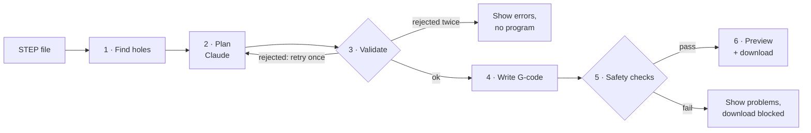

# Hole-CAM

Upload a STEP part and get back a checked drilling program. Claude plans the job, plain code writes the G-code, and safety checks block the download until the program is safe to send to a machine.

It's a weekend-sized version of the "engineering model → machining strategy → G-code" problem: holes only, one setup, a 3-axis mill.


<sub>NIST part FTC-07, an open box with counterbored holes on bosses inside, and its 4-page drawing. The callouts read off the drawing and the plan are Claude's, from a live run; whether each hole needs reaming is decided by code. The recording replays that answer and skips ahead to the reaming; live, a plan like this takes about a minute.</sub>

## What Claude does here

- **Plans the job.** From the holes found in the model, it picks the operations, tools, drilling cycles and order, with a one-line reason a machinist can check for each.
- **Reads the drawing.** Given the part's PDF drawing, it reads the hole callouts off the page, even when they're only lines with no text. Code converts them and decides which holes must be reamed or tapped.
- **Takes changes in plain English.** "Do the deep holes first" or "tap the 5 mm holes M6" gives a revised, re-checked plan, or a refusal with the reason when the change would break a shop rule.
- **Never gets the last word.** Speeds, feeds and coordinates are computed, and the few numbers Claude picks (spot depth, peck size) are bounds-checked. Each plan is validated against about 30 rules, gets one retry with the exact errors, and the program must pass six safety checks. An eval of 63 plans on three models measures how often that's needed.

How it's prompted, constrained, tested and measured: **[docs/AI-IN-HOLE-CAM.md](docs/AI-IN-HOLE-CAM.md)**.

## The user and the problem

The user is a CNC programmer turning a customer's CAD model into a program the machine can run. Hole-making is a large share of that work, and most of it is repetitive: find every hole, pick the drill, decide whether to peck, set speeds and feeds, order the holes, write the cycles. It's also where small slips are expensive. A rapid move at the wrong height, a missing tool length offset or a stopped spindle can break a tool, scrap the part or crash the spindle.

So the goal isn't just "generate G-code fast". It's to generate it fast **and** show the programmer why each choice was made, while refusing to hand over a program that fails basic safety checks.

## What it does



1. **Find holes** in the STEP geometry, turn the part so the most holes face up, and skip any it can't drill in one setup, with the reason.
2. **Plan** with Claude: operations, tools, cycles, order and reasons, plus the drawing's callouts if a PDF was uploaded.
3. **Validate** the plan with plain code. A rejected plan goes back to Claude once with the errors listed.
4. **Write G-code** with plain code. Speeds and feeds come from a material table; a tap's feed is always rpm × pitch.
5. **Safety-check** the program by reading it back line by line: rapids into the part, cutting with the spindle off, tool length offsets, machine limits, drilling too deep, and an unsafe end. The checks work on any Fanuc-style drilling program.
6. **Preview** the part and toolpath in 3D, drawn from the G-code itself, with a playback of every move and an estimated cycle time.
7. **Change the plan in plain English**, with the operations and cycle time before and after, and Undo.

Each stage in detail: [docs/HOW-IT-WORKS.md](docs/HOW-IT-WORKS.md). New to machining? [docs/MANUFACTURING-PRIMER.md](docs/MANUFACTURING-PRIMER.md) explains the terms.


<sub>A live run on the mixed test plate, paused partway through the revised program.</sub>

## How I know it works

- **Automated checks:** 143 Python tests, 8 web unit tests, lint and type checks, all run by `scripts/check.sh` in CI and before every commit. The tests never call the Claude API: a fake client returns canned plans to test the retry and revision flow, and every error the validator can return has a deliberately broken plan that triggers it.
- **An eval of the planner:** `scripts/eval.py` plans 7 parts 3 times each on Opus, Sonnet and Haiku 5.5, and scores every run with validation, the safety checks and drawing answers written by hand. All 63 plans were valid after at most one retry and passed the checks, but a quarter to a third of first attempts were rejected. Sonnet read every called-out hole, as Opus did, at 41% of the cost. Haiku missed some callouts and still passed every check, which is why the drawing answers are scored. The results are committed, and one command rebuilds the table ([details](docs/AI-IN-HOLE-CAM.md#how-well-it-works)).
- **Real parts:** 11 CAD parts from NIST, most of them inch parts modeled on their side or around their center. They exposed three hole-finding bugs, a missing set of inch drills, and a wrong drilling order the safety checks can't see, now caught by the validator. Three of the parts are in the repo. Four parts were checked against their drawings and match exactly. On three NIST drawings Claude read the hole callouts, including tolerances that need reaming and M3 threads that need tapping ([details](docs/REAL-PARTS.md)).
- **A second opinion from LinuxCNC:** 10 programs were run by hand (it needs Docker, so it isn't in CI) through LinuxCNC's own G-code interpreter (`scripts/linuxcnc_check.py`, in Docker). All read without error, every move matches the toolpath the safety checks traced, and the holes LinuxCNC's moves cut match the plan, taps included. Its first run found two real bugs, now fixed ([details](docs/REAL-PARTS.md#proving-the-programs-out-on-linuxcnc)).
- **Safety checks:** a set of 20 programs, 18 with one planted problem each and 2 clean. **18/18 caught, 0 false alarms.** Each bad program must trip exactly its planted check.
- **Hole finding** is tested on five generated parts with known answers, two of them also with every hole split into half-faces as real CAD exports often do, and on NIST FTC-07 and FTC-08 against their drawings.
- **G-code:** the reference program's speeds, feeds, depths and hole order were checked by hand against the formulas, and a test fails if the output ever changes.
- **The web page:** a repeatable browser check (`cd web && npm run e2e`, planner faked) uploads a part, waits for the checks, confirms playback starts and highlights the running G-code line, revises the plan and undoes it. Light and dark mode, phone width, the playback slider and reduced motion were checked by hand.

**Checked outside the code, and not yet:**
- [x] STEP files exported from real CAD software ([11 NIST parts](docs/REAL-PARTS.md))
- [x] The programs read by an independent controller's interpreter ([LinuxCNC](docs/REAL-PARTS.md#proving-the-programs-out-on-linuxcnc))
- [ ] The programs proven out on a machine
- [ ] Speeds and feeds checked against a drill maker's chart. Today they're conservative starting values.

## What I'd measure in a plant

- Programming time per part for hole-making, before and after.
- How often programmers edit the generated program before running it, and what they change. That's the best feedback for the planner prompt and the validator.
- Problems found at prove-out (first run on the machine) for generated programs versus hand-written ones.
- How often the checks block a program, and whether each block was a real problem.

## Limits and next steps

- **Holes only, one setup, Fanuc-style metric programs.** No boring, thread milling, pockets, chamfers or profiles. The part is turned so the axis with the most holes points up; holes on other sides or angled faces are skipped. Inch parts and inch tools work.
- **Reaming and tapping** only with the reamers and taps in the library. A thread's depth on the drawing isn't read: blind holes are tapped to one thread short of the bottom.
- **Counterbores** come out as two holes, one per diameter, drilled with a pointed drill. Opus warned that the floor needs a flat-bottom tool in every eval run; Sonnet and Haiku rarely did.
- **Tool reach** isn't checked: a hole deep inside a box needs a tool and holder long enough to reach it without hitting the walls.
- **Safety checks:** the rapid check looks at each move's start and end points, not the full path, and only knows the surface height at hole centers. "Too deep" is measured against the bottom of the part, not each blind hole's depth.
- **Drawing tolerances only choose reaming or drilling.** A drill must still match the model's size within 0.02 mm, even when a nearby drill would land inside the drawing's tolerance.
- **Estimates:** the cycle time uses typical machine values, and the speeds and feeds are unverified starting values. Nothing it produces should run without a machinist's review.
- **Next:** a post-processor per machine, a rules-only planner to compare against Claude's plans, and a record of operator feedback on each job.

## Running it

Needs Python 3.12 with [uv](https://docs.astral.sh/uv/), Node 22.18+, and an Anthropic API key.

```bash
uv sync
(cd web && npm install && npm run build)
cp .env.example .env                  # then put your key in .env (it's git-ignored)
uv run --env-file .env uvicorn hole_cam.api:app       # open http://127.0.0.1:8000
```

For development, add `--reload` to the API command and run `npm run dev` in `web/`.

Checks: `scripts/check.sh` runs lint, the Python tests and the web type-check and unit tests; CI runs it on pushes to `main` and on pull requests. Turn it on as a pre-commit hook once per clone with `git config core.hooksPath .githooks`. The browser check (`cd web && npm run e2e`) needs a one-time `npx playwright-core install chromium-headless-shell` in `web/`.

Command-line versions of each step:

```bash
uv run --env-file .env python -m hole_cam.planner fixtures/parts/mixed.step 6061 > plan.json
uv run --env-file .env python -m hole_cam.planner fixtures/nist/nist_ftc_07_asme1_rd.stp 6061 fixtures/nist/nist_ftc_07_asme1_rd.pdf > ftc07.json  # with its drawing
uv run --env-file .env python -m hole_cam.planner fixtures/nist/nist_ftc_10_asme1_rb.stp 6061 fixtures/nist/nist_ftc_10_asme1_rb.pdf > ftc10.json  # M3 threads
uv run python -m hole_cam.gcode   fixtures/parts/mixed.step plan.json 6061 > mixed.nc
uv run python -m hole_cam.checks  mixed.nc fixtures/parts/mixed.step
uv run python scripts/linuxcnc_check.py fixtures/parts/mixed.step plan.json 6061   # LinuxCNC second opinion, needs Docker
uv run --env-file .env python scripts/eval.py --settings opus-5-5/medium,sonnet-5-5/medium   # planner eval, about $3; add --estimate to price it first
```

Regenerate the test fixtures with `uv run python fixtures/make_parts.py` and `uv run python fixtures/make_bad_gcode.py`.

On Intel Macs, a few CadQuery dependencies are pinned to their last releases with Intel builds (see `pyproject.toml`).

## Project layout

| Path | What |
|---|---|
| `src/hole_cam/holes.py` | Find holes in a STEP file |
| `src/hole_cam/planner.py` | Claude's plan and revisions, and the validator |
| `src/hole_cam/gcode.py` | Plan to G-code |
| `src/hole_cam/checks.py` | G-code safety checks and toolpath trace |
| `src/hole_cam/api.py` | HTTP API and static web page |
| `src/hole_cam/data.py` | Loads the files in `data/` |
| `data/` | Tool library (drills, reamers, taps), materials, machine limits |
| `web/` | React and three.js front end; unit tests in `web/test/`, browser check in `web/e2e/` |
| `tests/` | Python tests |
| `scripts/check.sh` | Lint, tests and type checks; run by CI and the pre-commit hook |
| `scripts/eval.py` | Runs the planner on 7 parts per model setting and prints a scorecard |
| `scripts/linuxcnc_check.py` | Runs a program through LinuxCNC's interpreter and compares |
| `scripts/fake_planner_api.py` | The API with Claude faked, for the browser check |
| `fixtures/` | Test parts (generated and from NIST), plans, reference program, bad G-code set, drawing answers for the eval |
| `evals/results/` | The first eval sweep's raw results |
| `docs/AI-IN-HOLE-CAM.md` | How Claude is used: prompt, schema, safeguards, eval |
| `docs/HOW-IT-WORKS.md` | What each stage does and why |
| `docs/REAL-PARTS.md` | Results on 11 real NIST parts, and what they broke |
| `docs/MANUFACTURING-PRIMER.md` | Machining terms explained for non-machinists |

Built with Claude Code as a pair programmer. Every step has its own tests, and the numbers above come from running them.
