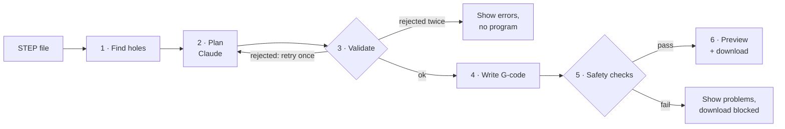
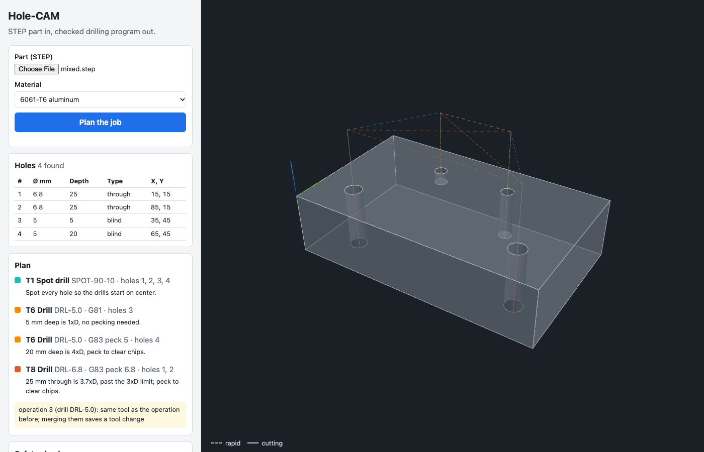

# Hole-CAM

Upload a STEP part and get back a checked drilling program. Claude plans the job, plain code writes the G-code, and safety checks block the download until the program is safe to send to a machine.

It's a weekend-sized version of the "engineering model → machining strategy → G-code" problem: holes only, one setup, a 3-axis mill.


<sub>NIST part FTC-07, an open box with counterbored holes on bosses inside, and its 4-page drawing. The callouts read off the drawing and the plan are Claude's, from a live run; whether each hole needs reaming is decided by code. The recording replays that answer and skips ahead to the reaming: live, the plan took 63 s.</sub>

## The user and the problem

The user is a CNC programmer turning a customer's CAD model into a program the machine can run. Hole-making is a large share of that work, and most of it is repetitive: find every hole, pick the drill, decide whether to peck, set speeds and feeds, order the holes, write the cycles. It's also where small slips are expensive. A rapid move at the wrong height, a missing tool length offset or a stopped spindle can break a tool, scrap the part or crash the spindle.

So the goal isn't just "generate G-code fast". It's to generate it fast **and** show the programmer why each choice was made, while refusing to hand over a program that fails basic safety checks.

## What it does



1. **Find holes:** reads the STEP geometry and finds inner cylindrical faces that go all the way around, merging the split halves many CAD exporters produce. Rounded inside corners and slot ends are curved too, but they aren't holes. The part is turned so the side with the most drillable holes faces up, and moved so its front-left corner is X0 Y0. It tells through holes from blind holes by what closes the bottom (the part's underside, a flat floor or a drill point). Holes it can't drill in one top-side setup are reported as skipped, with a reason.
2. **Plan:** Claude gets the holes, the material, the tool library and the machine limits. It returns a plan in a fixed JSON format: spot drill, then drill, G81 or G83 peck drilling, holes grouped by tool, and a one-line reason for each operation.
   - **With the drawing:** upload the part's PDF drawing too, and Claude reads the hole callouts off it, even when they're only lines on the page. Code converts them to mm and decides what each needs: a hole tighter than a drill can hold is drilled under size and reamed (G85), and a thread callout is drilled with its tap drill and tapped (G84).
3. **Validate:** plain code checks the plan. It rejects the wrong drill size, holes drilled before they're spotted, holes drilled twice or missed, drills too short for the depth, and deep holes without pecking. With a drawing, it also rejects callouts that don't match the model's holes, tight holes that aren't reamed properly, and threads not tapped or tapped with the wrong tap or drill. A rejected plan goes back to Claude once with the errors listed.
4. **Write G-code:** plain code. Speeds and feeds come from a material table, never from the model. A tap's feed is always rpm × pitch.
5. **Safety checks:** a G-code reader tracks the machine's state line by line and runs six checks:
   - rapid moves into the part
   - cutting with the spindle off
   - a missing or wrong tool length offset
   - speed or feed above the machine's limits
   - drilling past the bottom of the part
   - an unsafe end of program or tool change

   The checks work on any Fanuc-style drilling program, not just this tool's.
6. **Preview:** the part and toolpath in 3D. The toolpath is drawn by reading back the generated G-code, so it shows what the machine will do, not what was intended. The view plays the program back: the drill moves through every move, including each peck out to clear chips, and the holes fill in as they're drilled. The G-code line being run is highlighted. The same moves give an estimated cycle time (about 32 s for the test plate).
7. **Change the plan in plain English:** a machinist types a change like "do the deep holes first", "peck every hole, 2 mm at a time" or "tap the 5 mm holes M6". Claude revises the plan and explains what it changed, or why it couldn't. The revision is validated and checked like any plan. The page shows the operations added and removed and the cycle time before and after, with Undo.


<sub>A live run on the mixed test plate, paused partway through the revised program.</sub>

## Where the AI is, and where it isn't

Claude does the part that's judgment: choosing operations and order, matching tools to holes, deciding when to peck, and explaining its choices in a machinist's terms. It also takes requested changes in plain English, and pushes back when a request would break a shop rule.

Anything that can break a tool if it's wrong is plain, tested code: geometry, feeds and speeds, G-code syntax and the safety checks. The model's output is treated as a proposal. Its format is enforced by a schema, its tool IDs are limited to the real library, and every plan is validated before any G-code exists.

## How I know it works

- **137 automated tests:** `uv run pytest`.
- **An eval of the planner:** `scripts/eval.py` plans 7 parts 3 times each per model, and scores every run with validation, the safety checks and drawing answers written by hand. On 63 plans, Opus, Sonnet and Haiku 5.5 were all valid after at most one retry and all passed the checks. Sonnet read every called-out hole on the drawings, as Opus did, at 41% of the cost. Haiku missed some callouts and still passed every check, which is why the drawing answers are scored. Details: [docs/AI-IN-HOLE-CAM.md](docs/AI-IN-HOLE-CAM.md#measured-with-the-eval).
- **A second opinion from LinuxCNC:** every program below was also run through LinuxCNC's own G-code interpreter, the one real machines run (`scripts/linuxcnc_check.py`, in Docker). All 10 read without error, every move matches the toolpath the safety checks traced (up to 289 moves each), and the holes LinuxCNC's moves cut match the plan, taps included. Its first run found two real bugs, now fixed: a `G43` line relying on `G00` being still in effect, which LinuxCNC rejects, and nested parentheses in tool comments. Details: [docs/REAL-PARTS.md](docs/REAL-PARTS.md#proving-the-programs-out-on-linuxcnc).
- **Real parts:** 11 real CAD parts from NIST, most of them inch parts modeled on their side or around their center. They exposed three hole-finding bugs, a missing set of inch drills and a gap in the safety checks; all are fixed. Four parts were checked against their drawings and match exactly, and two are now regression tests. Live plans on four parts all passed the safety checks. Details: [docs/REAL-PARTS.md](docs/REAL-PARTS.md).
- **Hole finding** is also tested on five generated parts with known answers: a plate, mixed through and blind holes with a drill-point bottom, an odd size with no matching drill, a side hole and a hole drilled up from the bottom, and a boss whose outer wall must not count as a hole. Two of the parts are also re-run with every hole split into half-faces, as real CAD exports often do.
- **G-code:** the reference program's speeds, feeds, depths and hole order were checked by hand against the formulas, and a test fails if the output ever changes.
- **Safety checks:** a set of 20 programs, 18 with one planted problem each and 2 clean. Result: **18/18 caught, 0 false alarms.** Each bad program must trip exactly its planted check.
- **The validator caught a mistake in my own plan:** I'd written plain drilling for 25 mm deep, 6.8 mm holes. That's 3.7× the diameter, past the 3× peck rule the tool is meant to enforce.
- **Reading a real drawing, live:** NIST FTC-07's 4-page drawing has dimensions drawn as lines, with no text to search. Claude returned all six hole callouts for the drilling side with the right sizes and tolerances, and left out the ones for side holes. Code flagged the 8 Ø.250 +.003" holes for reaming, and the plan spots, drills 6.0 mm and reams them with a 1/4" reamer. It passed validation first time and all six safety checks; over the eval's three runs, first-time passes happened once, so the retry matters. The drawing roughly doubles the cost of a plan, to $0.17. FTC-08 with its drawing also passed first time ($0.12).
- **Tapping from a real drawing, live:** FTC-10's 5-page drawing has three `2X M3x0.5-6g` callouts on page 4. Claude found them, and the plan drills those six holes 2.5 mm and taps them M3 on `G84`. It also pointed out, unprompted, that "6g" is a class for external threads. It passed first time ($0.25, 95 s). Details: [docs/REAL-PARTS.md](docs/REAL-PARTS.md#reading-the-drawings).
- **Live run:** the mixed plate through the real API and web page. Claude's plan passed validation and the program passed all six checks. Unprompted, Claude also warned that the 6.8 mm and 5.0 mm holes are M8 and M6 tap-drill sizes, so tapping may be missing. Planning takes about 15–20 seconds.
- **Plan changes, live:** on the mixed plate, "do the deep holes first" was reordered without adding a tool change. "Skip spot drilling to save time" was declined with the reason, plus a cheaper change that was allowed. "Peck every hole, 2 mm at a time" was applied, with two operations merged, and the cycle time went from 0:35 to 0:40. Each took 6–9 seconds. "Tap the 5 mm holes M6 and the 6.8 mm holes M8" added both taps, kept the drills as the tap drills, and warned that the 5 mm deep blind hole gets only 2–3 full threads (10.5 s, $0.04).
- **The web page** was also driven in a real browser in light mode, dark mode and at phone width, with the planner faked. For the playback, the check confirms it starts by itself and advances, the highlighted G-code line follows the slider, the end shows Replay, and it doesn't start by itself when reduced motion is on.

**Not verified yet:**
- [x] STEP files exported from real CAD software ([11 NIST parts](docs/REAL-PARTS.md))
- [x] The programs read by an independent controller's interpreter ([LinuxCNC](docs/REAL-PARTS.md#proving-the-programs-out-on-linuxcnc))
- [ ] The programs proven out on a machine
- [ ] Speeds and feeds checked against a drill maker's chart. Today they're conservative starting values.

## What I'd measure in a plant

- Programming time per part for hole-making, before and after.
- How often programmers edit the generated program before running it, and what they change. That's the best feedback for the planner prompt and the validator.
- Problems found at prove-out (first run on the machine) for generated programs versus hand-written ones.
- How often the checks block a program, and whether each block was a real problem.

## Limits and next steps

- **v1 scope:** round holes drilled from one side of the part, in one setup, Fanuc-style. The part is turned to whichever of its six sides has the most holes to drill. Boring, thread milling, counterbores with flat floors, pockets, chamfers and multiple setups are out of scope. Reaming and tapping work for the reamer and tap sizes in the library; the thread depth on the drawing isn't read yet.
- **Tool reach** isn't checked: a hole deep inside a box needs a tool and holder long enough to reach it without hitting the walls.
- **Safety checks:** the rapid check looks at each move's start and end points, not the full path, and only knows the surface height at hole centers. "Too deep" is measured against the bottom of the part, not each blind hole's depth.
- **Drawing tolerances only choose reaming or drilling.** A drill must still match the model's size within 0.02 mm, even when a nearby drill would land inside the drawing's tolerance.
- **Next:** a post-processor per machine, a rules-only planner to compare against Claude's plans, and a record of operator feedback on each job.

## Running it

Needs Python 3.12 with [uv](https://docs.astral.sh/uv/), Node 20+, and an Anthropic API key.

```bash
uv sync
(cd web && npm install && npm run build)
cp .env.example .env                  # then put your key in .env (it's git-ignored)
uv run --env-file .env uvicorn hole_cam.api:app       # open http://127.0.0.1:8000
```

For development, add `--reload` to the API command and run `npm run dev` in `web/`.

Command-line versions of each step:

```bash
uv run --env-file .env python -m hole_cam.planner fixtures/parts/mixed.step 6061 > plan.json
uv run --env-file .env python -m hole_cam.planner fixtures/nist/nist_ftc_07_asme1_rd.stp 6061 fixtures/nist/nist_ftc_07_asme1_rd.pdf > ftc07.json  # with its drawing
uv run --env-file .env python -m hole_cam.planner fixtures/nist/nist_ftc_10_asme1_rb.stp 6061 fixtures/nist/nist_ftc_10_asme1_rb.pdf > ftc10.json  # M3 threads
uv run python -m hole_cam.gcode   fixtures/parts/mixed.step plan.json 6061 > mixed.nc
uv run python -m hole_cam.checks  mixed.nc fixtures/parts/mixed.step
uv run python scripts/linuxcnc_check.py fixtures/parts/mixed.step plan.json 6061   # LinuxCNC second opinion, needs Docker
uv run --env-file .env python scripts/eval.py --settings opus-5-5/medium,sonnet-5-5/medium   # planner eval, about $3
```

Regenerate the test fixtures with `uv run python fixtures/make_parts.py` and `uv run python fixtures/make_bad_gcode.py`.

On Intel Macs, a few CadQuery dependencies are pinned to their last releases with Intel builds (see `pyproject.toml`).

## Project layout

| Path | What |
|---|---|
| `src/hole_cam/holes.py` | Find holes in a STEP file |
| `src/hole_cam/planner.py` | Claude plan and validation |
| `src/hole_cam/gcode.py` | Plan to G-code |
| `src/hole_cam/checks.py` | G-code safety checks and toolpath trace |
| `src/hole_cam/api.py` | HTTP API and static web page |
| `web/` | React and three.js front end |
| `data/` | Tool library (drills, reamers, taps), materials, machine limits |
| `scripts/linuxcnc_check.py` | Runs a program through LinuxCNC's interpreter and compares |
| `scripts/eval.py` | Runs the planner on 7 parts per model setting and prints a scorecard ([SPEC-eval.md](SPEC-eval.md)) |
| `fixtures/` | Test parts (generated and from NIST), plans, reference program, bad G-code set |
| `docs/HOW-IT-WORKS.md` | What each stage does and why |
| `docs/REAL-PARTS.md` | Results on 11 real NIST parts, and what they broke |
| `docs/AI-IN-HOLE-CAM.md` | How Claude is used: prompt, schema, safeguards, measured cost |
| `docs/MANUFACTURING-PRIMER.md` | Machining terms explained for non-machinists |
| `docs/DEMO-SCRIPT.md` | A four-minute walkthrough and answers to likely questions |
| `SPEC.md` | The original weekend spec |

Built with Claude Code as a pair programmer. Every step has its own tests, and the numbers above come from running them.
