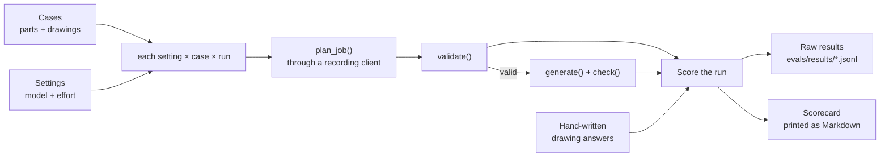

# Spec: Planner eval harness

## Objective

Today, the only evidence that Claude's plans are good is live runs done by hand and written up in `docs/AI-IN-HOLE-CAM.md` and `docs/REAL-PARTS.md`. Nothing re-runs them. A prompt edit, a model change or an effort change could make plans worse and nobody would know.

Build `scripts/eval.py`, which runs the real planner over a fixed set of parts, several times for each model setting, scores every run with the code that already exists (validation, G-code writing, the six safety checks) plus hand-written drawing answers, and prints a scorecard.

**User:** me, before and after changing the prompt, model, effort, or (next) prompt caching. In an interview it answers: "how do you know it works, and how would you know if a change broke it?"

**Success looks like:** one command gives a table like the one below, and its numbers make the decisions. Which model or effort to use, and whether a prompt change helped, comes from the table, not from a feeling.

| Setting | Valid 1st try | Valid | Safe | Callouts found | Extra callouts | Same plan | $/plan | p50 s |
|---|---|---|---|---|---|---|---|---|
| opus-5-5 / medium | … | … | … | … | … | … | … | … |
| sonnet-5-5 / medium | … | … | … | … | … | … | … | … |

## How it runs



### Cases (v1)

| Case | Part | Drawing | What it tests |
|---|---|---|---|
| `mixed` | `fixtures/parts/mixed.step` | no | Peck rule, grouping; compared with the hand-checked plan `fixtures/plans/mixed.json` |
| `boss` | `fixtures/parts/boss.step` | no | Compared with the hand-checked plan `fixtures/plans/boss.json` |
| `odd_size` | `fixtures/parts/odd_size.step` | no | Leaves out a hole no drill fits, and warns about it |
| `plate_4_through` | `fixtures/parts/plate_4_through.step` | no | Simplest case: a floor for cost and speed |
| `ftc07` | NIST FTC-07 | yes, 4 pages | Reading callouts drawn as lines; reaming |
| `ftc08` | NIST FTC-08 | yes | Many callouts, none needing reaming |
| `ftc10` | NIST FTC-10 | yes, 5 pages | Thread callouts on page 4; tapping; a G6 fit with no reamer |

All cases use 6061. Plan changes ("peck every hole…") are out of v1; see Decisions.

### Settings (v1)

`opus-5-5/medium` (today's setting, the baseline), `opus-5-5/low`, `sonnet-5-5/medium`, `haiku-5-5/medium`. Chosen with `--settings`; the default is the baseline alone.

### What each run records

One JSON line per run: case, setting, run number, and:

| Field | Meaning |
|---|---|
| `valid_first` | No validation errors on attempt 1 |
| `valid` | No validation errors after the retry |
| `safe` | Valid, the G-code was written, and all six checks pass (the same rule as `export_ok` in `api.py`) |
| `errors` | Validation errors, or the exception text if the planner failed (refusal, cut off, API error). A failed run counts as not valid; it doesn't stop the sweep. |
| `attempts` | 1 or 2 |
| `first_errors` | The validation errors that sent attempt 1 back, so a retry rate can be traced to the rules it broke |
| `input_tokens`, `output_tokens`, `cost_usd`, `seconds` | Summed over attempts. Cost from a price table in the script. |
| `served_model` | The model the API says answered. If it isn't the model asked for, the server-side fallback answered, and the run is flagged `fallback`, so a Haiku score isn't really an Opus score. |
| `ops` | The plan's operations reduced to a comparable form: a sorted set of `(op, tool_id, sorted hole_ids, cycle)`. Order, spot depth and peck size are left out. They vary between good plans. |
| `matches_reference` | `ops` equals the reference plan's `ops` (only `mixed` and `boss`) |
| `callouts` | Drawing scores, below (drawing cases only) |
| `warnings` | How many, and their text |
| `plan` | The whole plan, so any run can be looked at later |

### Scoring the drawing

Answers are hand-written from the NIST PDFs into `fixtures/eval/<case>.truth.json`, never from the app's output, the same rule as `fixtures/nist/README.md`. `docs/REAL-PARTS.md` ("Reading the drawings") already lists them for FTC-07 and FTC-10.

They're scored by **hole groups, not callouts**, because the same holes can be called out once (`8X`) or split into four `2X` callouts, and which identical callout went to which hole isn't checked. A group is a diameter in mm, its tolerance and its thread pitch, after `drawing_callouts()` converts Claude's numbers:

```json
{"diameter_mm": 6.35, "plus_mm": 0.0762, "minus_mm": 0.0, "pitch_mm": 0, "holes": 8, "needs": "ream"}
```

- **Found:** the truth's holes covered by returned callouts with the same group (diameter within 0.01 mm, tolerances within 0.003 mm, same pitch), as a share of the truth's holes.
- **Extra:** holes in returned callouts that match no truth group (made up, or from a side face), plus holes beyond a group's count.

`needs` isn't scored per run: once a group's numbers match, code's ream/tap/drill answer follows from them. Instead a test checks that code's answer on each truth file matches `needs`, which guards both the truth files and the rules.

### The scorecard

Per setting, across all cases and runs: share valid first try, share valid, share safe, drawing found and extra, share of runs with the case's most common `ops` ("Same plan"), mean $ per plan, median and slowest seconds, and how many runs used the fallback. With `--by-case` there's one row per setting and case. It's printed as Markdown so it pastes straight into `docs/AI-IN-HOLE-CAM.md`.

## Tech stack

Python 3.12, the existing `anthropic` SDK, the project's own modules. **No new dependencies.** No eval framework: the scoring is about 100 lines and is specific to this app.

## Commands

```bash
uv run --env-file .env python scripts/eval.py                                    # baseline, 3 runs per case
uv run --env-file .env python scripts/eval.py --settings opus-5-5/medium,sonnet-5-5/medium --runs 5
uv run --env-file .env python scripts/eval.py --cases ftc07,ftc10 --by-case
uv run python scripts/eval.py --estimate                                          # cost estimate only, no API calls
uv run python scripts/eval.py --summarize evals/results/2026-11-08T140000.jsonl    # reprint a scorecard from saved results
uv run pytest                                                                     # includes the scoring tests
```

`--max-cost` (default `$5`) stops the sweep before the next run once the money spent reaches it. A full sweep of the baseline is about $2 (3 runs × the 7 cases' costs in `docs/AI-IN-HOLE-CAM.md`), so all four settings are about $6–8.

## Project structure

```
scripts/eval.py                      → the harness: cases, settings, recording client, scoring, scorecard
fixtures/eval/ftc07.truth.json       → hand-written drawing answers (one per drawing case)
fixtures/eval/ftc08.truth.json
fixtures/eval/ftc10.truth.json
evals/results/                       → raw JSONL per sweep, git-ignored
tests/test_eval.py                   → scoring tests, no API calls
docs/AI-IN-HOLE-CAM.md               → gains a "Measured with the eval" section with the first scorecard
```

## Code style

Match the repo: plain functions, short docstrings, `shortcut:` comments for known limits, no classes unless something holds state.

**No change to the planner.** The eval passes its own client to `plan_job()`, the same seam the `FakeClient` tests use. The client sets the model and effort for the setting under test and records usage on the way through:

```python
class RecordingClient:
    """Wraps anthropic.Anthropic(): runs the request on this setting's model and effort, and records usage."""

    def __init__(self, model, effort):
        self.inner, self.model, self.effort, self.calls = anthropic.Anthropic(), model, effort, []
        self.beta = SimpleNamespace(messages=SimpleNamespace(create=self.create))

    def create(self, **kw):
        kw = {**kw, "model": self.model, "output_config": {**kw["output_config"], "effort": self.effort}}
        start = time.monotonic()
        response = self.inner.beta.messages.create(**kw)
        self.calls.append({"seconds": time.monotonic() - start, "model": response.model,
                           "input_tokens": response.usage.input_tokens, "output_tokens": response.usage.output_tokens})
        return response
```

The cost of this choice: if `_ask()` ever stops sending `model` or `output_config.effort`, the override silently does nothing. A test asserts the request reaching the client carries the setting's model and effort.

## Testing strategy

`tests/test_eval.py`, pytest, no network:

- **Drawing scoring:** one `8X` callout and the same holes split into four `2X` callouts score the same; a callout off by 0.02 mm is not found; a side-face callout counts as extra; the action check reads `drawing_callouts()`.
- **`ops` comparison:** a reordered plan, or one with a different spot depth or peck, compares equal; a different tool or cycle doesn't.
- **One whole run** through a `FakeClient` that returns `fixtures/plans/mixed.json`: valid first try, safe, matches the reference, and the recorded line has every field.
- **Recording client:** the request carries the setting's model and effort; a `served_model` that differs is flagged as fallback.
- **Cost guard:** with a fake cost per call, the sweep stops once `--max-cost` is reached.

The harness itself is checked once live: a baseline sweep must roughly reproduce the documented single runs (FTC-07 and FTC-08 valid first try, every case safe). If it doesn't, the harness is wrong or the documented results were lucky, and either needs writing up.

## Boundaries

- **Always:** keep the scoring in plain code; write truth files from the drawings; record failed runs instead of dropping them; print the run count beside every percentage (3 runs is a small sample, and the table must say so).
- **Ask first:** changing anything in `src/hole_cam/` (the planner stays untouched in v1); adding a dependency; any sweep over `$5`; adding LLM-as-judge scoring.
- **Never:** call the API from `pytest`; tune the prompt in the same change as the harness (the first scorecard is the baseline the next prompt change is measured against); commit raw results or API keys.

## Success criteria

1. `scripts/eval.py` runs the 7 cases on the baseline setting, 3 runs each, under $5, and prints the scorecard.
2. Every run, including failures, is a line in `evals/results/<timestamp>.jsonl`, and `--summarize` rebuilds the same scorecard from it.
3. Drawing scores use hand-written truth for FTC-07, FTC-08 and FTC-10.
4. `uv run pytest` passes, with the scoring tests above, and makes no API calls.
5. A run answered by the fallback model is flagged and counted in the scorecard.
6. `docs/AI-IN-HOLE-CAM.md` has the first baseline scorecard and at least one comparison (Sonnet or low effort), with what it means for the model choice.

## Out of scope (next, each measured with this harness)

- Prompt caching on the system prompt and drawing.
- A rules-only planner as a baseline row.
- Plan-change cases (requests with an expected "applied" or "declined").
- Logging the same fields from live jobs in `api.py`.

## Decisions (were open questions)

1. **FTC-08's truth** is transcribed from the PDF's four pages: 10×Ø.213, 4×Ø.238, 2×Ø.228 and 2×Ø.242 at +.005 −.001, and 2×Ø.250 at +.006 −.001. FTC-07's eight Ø.250 holes are two groups on the drawing: a `4X` at +.003 −.001 and four at +.003 −.000. FTC-10's truth is the table in `docs/REAL-PARTS.md`. To be checked against the drawings by a person.
2. **Sonnet and Haiku** stay in. All take `effort` and structured outputs. Haiku 5.5 has no server-side fallback, so the eval leaves `fallbacks` off for it. A fallback shows as a `fallback_message` entry in `usage.iterations`.
3. **Plan changes** are out of v1.
4. **3 runs per case.** Every percentage is printed beside its run count.
