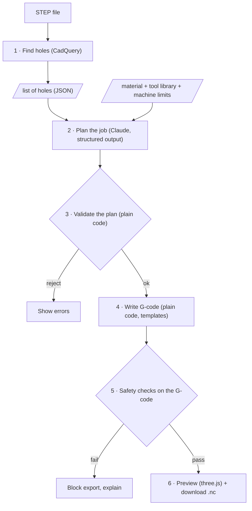

# Hole-CAM — Spec

A weekend project: upload a STEP part, get a checked drilling program (G-code) and a 3D preview of the toolpath.
It is a small version of what Re:CAM builds ("engineering models → machining strategies and G-code in seconds"). The goal is to show CAD/CAM ability for the Forward Deployed Software Engineer role at Re:CAM / Re:Build Manufacturing (Rock Hill, SC).

**Story in one line:** the AI plans the job, plain code writes the G-code, and checks catch mistakes before anything reaches a machine.

---

## 1. Why this project

| Posting asks for | This project shows it by |
|---|---|
| "Engineering models and drawings → machining strategies and G-code" | Doing exactly that, for holes |
| CAD/CAM software experience (the main gap on the resume) | Reading STEP geometry, choosing tools, writing drilling cycles |
| AI features built with LLMs | Claude plans the operations and returns structured output |
| "Accountable for correctness" of AI output | The plan is validated, G-code comes from plain code, and safety checks run on every program |
| "Validation when software interacts with production workflows" | The program is blocked from export if a check fails |
| Full-stack: UI, APIs, services | Python API + web UI with a 3D preview |
| Explain decisions, support adoption | The plan shows a plain-language reason for every operation |

Not covered (say so if asked): MES / shop-floor data, the edge-to-cloud link to machines, multi-setup parts. See the [project list](#9-related-projects).

---

## 2. Scope

### In scope (v1)
- **Input:** one STEP file (`.step`/`.stp`) in mm or inches, plus a material (6061 aluminum or 1018 steel).
- **Features:** round holes along the Z axis, opening on the top face. Both through holes and blind holes.
- **Operations:** spot drill → drill. Use peck drilling when the hole is deeper than 3× its diameter.
- **Machine:** a generic 3-axis vertical mill (Fanuc-style G-code). One setup, work offset G54 at the top of the part.
- **Output:** a `.nc` file, the operation plan as JSON, a checks report, and a 3D preview.

### Out of scope (v1). Name these as "next steps" in the demo
- Tapping (G84). Threads are rarely modeled in STEP files and rigid tapping needs feed = RPM × pitch. This is the first stretch goal.
- Pockets, contours, facing, chamfers, reaming, boring.
- Holes on the sides or the bottom (would need more setups or a 4th axis).
- Workholding, fixtures, toolpath optimization beyond nearest-neighbor ordering.
- Post-processors for other machine controls.

---

## 3. How it works



### 3.1 Find holes (CadQuery / OpenCascade)
- Load the STEP file with `cq.importers.importStep`.
- Go through the faces. Keep faces where `geomType() == "CYLINDER"`, then read the radius, axis and location from the underlying surface.
- Keep **inner** cylinders only: the surface normal points toward the axis. Outer bosses are ignored.
- Merge cylinder faces that share an axis and radius (one hole can be split into several faces).
- Keep holes whose axis is parallel to Z. Report the others as "skipped: not on the top face".
- **Depth:** measure from the top of the part to the lowest point of the cylinder.
- **Through or blind:** a through hole reaches the bottom of the part. A blind hole ends at a flat bottom or a drill-point cone.
- Output: `[{id, x, y, diameter, depth, through, top_z}]` in mm.

**Fallback if this eats Saturday:** let the user type the hole list in a form, and keep going. Planning, G-code, checks and preview matter most in the demo.

### 3.2 Plan the job (Claude)
- Model: `claude-opus-5-5` at effort `medium`, with the server-side refusal fallback on. Try `claude-sonnet-5-5` if cost matters; the validator will show whether quality holds.
- Input: the hole list, the material, the tool library (JSON), the machine limits.
- Output: JSON against a fixed schema (use tool use / structured output, not free text):
  ```json
  {
    "operations": [
      {"op": "spot_drill", "tool_id": "SPOT-90-10", "hole_ids": [1,2,3], "depth": 1.5, "reason": "..."},
      {"op": "drill", "tool_id": "DRL-6.8", "hole_ids": [1,2], "cycle": "G81", "reason": "..."},
      {"op": "drill", "tool_id": "DRL-5.0", "hole_ids": [3], "cycle": "G83", "peck": 5.0, "reason": "..."}
    ],
    "warnings": ["Hole 4 is 7.1 mm; no drill that size, would need a reamer or helical interpolation"]
  }
  ```
- The prompt says: only use tools from the library, spot drill every hole, peck when depth > 3×D, group holes by tool to reduce tool changes, and give a one-line reason for each operation.
- **Feeds and speeds are NOT decided by the LLM.** They come from a lookup table (step 4).

### 3.3 Validate the plan (plain code)
Reject the plan and show why if:
- a tool ID isn't in the library,
- a hole is missed, or a hole is drilled twice with the same operation,
- the drill diameter doesn't match the hole diameter (±0.02 mm),
- the drill can't reach the depth (flute length too short),
- a deep hole uses G81 instead of G83.

Optional: one automatic retry that sends the errors back to Claude.

### 3.4 Write G-code (plain code)
- Spindle speed: `RPM = (Vc × 1000) / (π × D)` from the material table (cutting speed Vc in m/min), capped at the machine's max RPM.
- Feed rate: `F = RPM × feed per rev` from the table, by drill diameter.
- Program layout:
  ```
  %
  O1000 (HOLE-CAM PART-NAME)
  G21 G90 G17 G40 G49 G80          (mm, absolute, XY plane, cancel offsets and cycles)
  G54
  T1 M06 (SPOT DRILL 10MM 90DEG)
  G43 H01 Z25.0 S2000 M03          (tool length offset, spindle on)
  M08
  G00 X10.0 Y10.0
  G98 G81 Z-1.5 R2.0 F150.         (spot each hole)
  X30.0 Y10.0
  G80
  M09
  M05
  G91 G28 Z0                        (home Z before the next tool)
  G90
  ... next tool ...
  M30
  %
  ```
- Hole order within each tool: nearest neighbor starting from the origin.
- Through-hole depth = part depth + breakthrough (drill point length + 1 mm).

### 3.5 Safety checks on the G-code
A small parser walks the program line by line and tracks the modal state (motion mode, spindle, tool, offsets, position). Each check gives a line number and a plain explanation.

| # | Check | Why it matters on the shop floor |
|---|---|---|
| 1 | Rapid move (G00) below the safe Z height while over the part | Crashes the tool into the part |
| 2 | Feed move or drilling cycle with the spindle off | Breaks the tool |
| 3 | Tool change with no G43 H before the first Z move | Wrong tool length → crash or air-cutting |
| 4 | Feed or RPM above the machine limits | The machine alarms or the tool fails |
| 5 | Drill depth below the part bottom + allowed breakthrough | Drills into the fixture or the table |
| 6 | Program doesn't end with M30, or a canned cycle isn't cancelled (G80) | Unsafe state for the next job |

The program runs these checks automatically. They can also be run by hand on any `.nc` file (CLI), so they work on programs that didn't come from this tool.

### 3.6 Preview (web)
- Backend exports the part as STL or glTF.
- three.js shows the part (half transparent) and the toolpath: rapids as dashed lines, feed moves as solid lines, one color per tool.
- Side panel: plan with reasons, checks report, download button (disabled if a check fails).

---

## 4. Stack

| Part | Choice | Why |
|---|---|---|
| Geometry | Python + CadQuery | Free and scriptable; can read STEP |
| API | FastAPI | Python, so it sits next to CadQuery; already on the resume |
| LLM | Anthropic Python SDK, structured output | Typed plan, easy to validate |
| UI | Vite + React + three.js (no extra 3D wrapper) | Small; React is on the resume |
| Tests | pytest | |
| G-code check | Own parser + NCViewer / CAMotics by hand | Independent visual check |

Data files (JSON, in the repo): `tools.json` (drill library), `materials.json` (Vc and feed per rev by diameter), `machine.json` (max RPM, max feed, safe Z, travel).

---

## 5. Test parts

Generate them with a CadQuery script (`fixtures/make_parts.py`) so the right answer is known exactly:

1. **Plate with 4 through holes**, same size → one drill, no peck.
2. **Mixed plate:** 2 through holes at 6.8 mm, 2 blind holes at 5 mm and 20 mm deep → two drills, peck on the deep ones.
3. **Odd size:** a 7.1 mm hole with no matching drill → a warning, not a made-up tool.
4. **Side hole:** one hole along X → reported as skipped.
5. **Boss:** an outer cylinder → must NOT be detected as a hole.

Plus one or two real STEP files (for example, a bracket from a public CAD library) to show it works on parts you didn't make.

### Bad G-code set (for the checks)
About 20 short `.nc` files, each with one planted problem (rapid into the part, missing G43, spindle off, etc.) plus a few clean ones. Report how many the checks catch and how many false alarms they raise. This is the eval number for the README.

---

## 6. Acceptance criteria

- [ ] Every test part gives the expected hole list (pytest).
- [ ] Plans for test parts 1–3 pass validation. Part 3 gives a warning and no made-up tool.
- [ ] Generated G-code for parts 1–2 passes all safety checks and looks right in NCViewer or CAMotics.
- [ ] The checks catch every planted problem in the bad G-code set, with 0 false alarms on the clean files.
- [ ] Breaking the plan on purpose (a wrong tool ID) shows an error in the UI, not G-code.
- [ ] Upload → preview in under ~15 s for the test parts.
- [ ] README written as a field report (section 8) + a 2-minute demo video.

---

## 7. Weekend plan

**Saturday: geometry and G-code**
1. Set up the repo, install CadQuery, write `make_parts.py` and generate the test parts.
2. Find holes, with pytest against the test parts. *Midday checkpoint: if this isn't working, switch to typing holes in by hand.*
3. Add the tool, material and machine JSON. Write the G-code generator with a hard-coded plan.
4. Open the output in NCViewer and fix it until it looks right.

**Sunday: AI, checks, UI, write-up**
5. Claude planning with the schema, plus plan validation.
6. G-code parser and the 6 safety checks, plus the bad G-code set.
7. FastAPI endpoints: `POST /jobs` (upload STEP + material) → plan, G-code, checks, preview mesh.
8. React page: upload, 3D preview, plan, checks, download.
9. README, demo video, push to GitHub.

**Stretch (only if there's time):** tapping with G84, a rules-only planner to compare against the LLM plan, chamfer passes.

---

## 8. README outline (field report)

1. **The user:** a CNC programmer who spends N minutes per part hand-writing drilling programs.
2. **The problem:** repetitive, error-prone, and one bad rapid move costs a tool, a part or a spindle.
3. **What I built:** pipeline diagram plus screenshots.
4. **Where the AI is, and where it isn't:** why planning uses an LLM but G-code and feeds and speeds don't.
5. **How I know it works:** test parts, checks eval numbers, NCViewer screenshots.
6. **What I'd measure in the plant:** programming time per part, how often programmers edit the output, issues found at prove-out.
7. **Next:** tapping, pockets, more setups, a real post-processor, feedback from operators.

---

## 9. Related projects

These could follow this one:
- **G-code checker as its own tool:** the checks from 3.5, as a CLI that works on any program.
- **Mini MES:** machine data (MTConnect) → OEE dashboard + operator tablet. Covers the MES / factory-floor part of the posting.
- **Drawing reader:** PDF drawing → structured job record, with a person confirming the fields.

---

## 10. Interview prep: know these cold

- Why spot drill before drilling: it keeps the drill from wandering and gives a centered start.
- G81 (plain drilling) vs G83 (peck drilling: pulls out to clear chips). Peck once depth is past about 3×D.
- G98 vs G99: return to the start height vs the R plane between holes.
- G43 H: tool length offset. Missing it is a classic crash.
- RPM from cutting speed, and feed from feed per rev (or chip load × flutes for end mills).
- Drill point angle (118° / 135°) and why through holes need extra depth.
- Work offsets (G54) and where you'd set zero on this part.
- Why this design keeps the LLM away from numbers that can break things.
