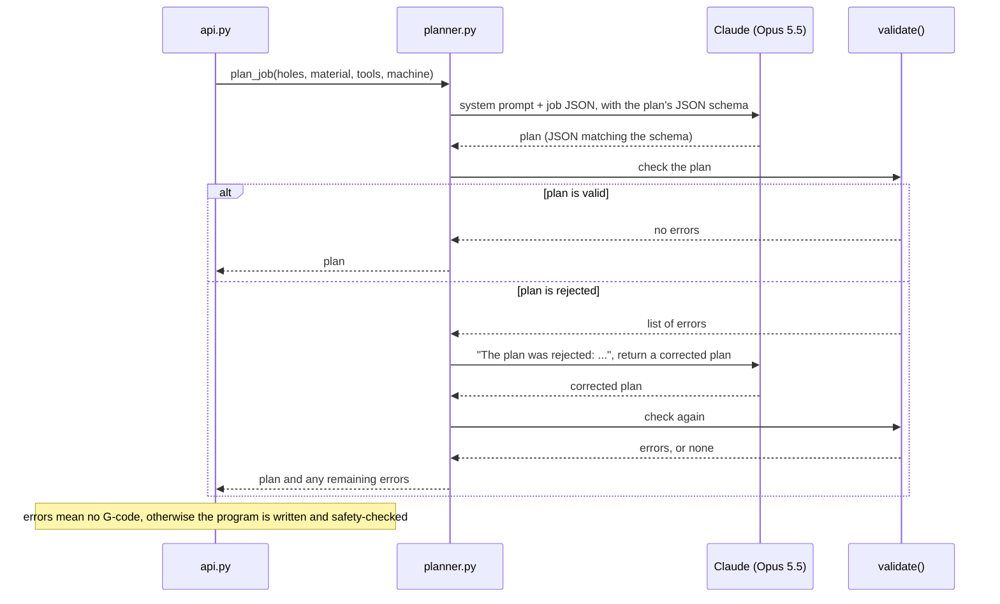
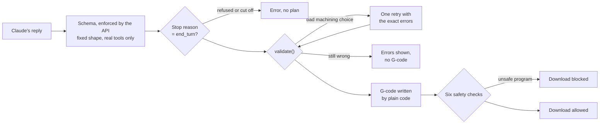

# How AI is used in Hole-CAM

Hole-CAM makes **one call to Claude per plan**, plus at most one retry. That call turns a list of holes into a drilling plan: which operations, which tools, which drilling cycle, in what order, and why. A machinist can then ask for changes in plain English, and each change is one more call ([Revising a plan](#revising-a-plan)). Everything else in the app is ordinary code. Claude's plan is treated as a proposal: its format is fixed by a schema, plain code validates it, and the final program is checked for crashes before anyone can download it.

All the code described here is in `src/hole_cam/planner.py`.

---

## Where the AI sits



---

## What Claude is asked to decide

| Claude decides | Plain code decides |
|---|---|
| Which operations to run (spot drill, drill, ream, tap) and in what order | Finding the holes and measuring them |
| What the drawing's hole callouts say, and which holes they point at | Converting them to mm, and whether a hole needs reaming or tapping |
| Which holes to tap, when the drawing or the machinist asks for threads | Whether the tap matches the thread, and its feed (rpm × pitch) |
| Which drill goes with each hole | Spindle speeds and feed rates |
| Plain drilling (G81) or peck drilling (G83), and the peck depth | Every coordinate and number in the G-code |
| How deep to spot each hole | Whether the plan is acceptable |
| What to warn the programmer about | Whether the finished program is safe to run |
| A one-sentence reason for every operation | |

The split follows one rule: **anything that can break a tool or crash the machine if it's wrong is computed, not generated.** Claude handles choices that need judgment and explanation. Those choices are then checked by code that doesn't need judgment.

---

## What Claude receives

### The system prompt

This is sent unchanged with every request. `{peck_ratio}` and `{drill_oversize}` are filled in from `data/machine.json`, which currently sets them to 3 and 0.1.

```text
You are a CNC programmer planning hole-making on a 3-axis vertical mill. One setup, parts are drilled from the top.

You get the holes found in the CAD model, the material, the tool library and the machine limits, and sometimes the part's engineering drawing as a PDF. Return a plan:
- Spot drill every hole you will drill, before drilling it. For a spot drill operation, set depth (mm below the hole top) so the spot cone is a little smaller than the drill. Use cycle G81 and peck 0.
- Drill each hole with the library drill whose diameter matches the hole. If no drill matches, do not drill that hole; add a warning naming the hole and what it would need (a reamer, a boring bar, helical interpolation).
- Use G83 peck drilling when the hole is deeper than {peck_ratio} x its diameter. Peck about 1 x the drill diameter. Otherwise use G81 with peck 0. For drill operations, set depth to 0 (the depth comes from the model).
- Group holes that share a tool and cycle into one operation to keep tool changes down.
- Tap a hole only when the drawing calls it out as a thread or the machinist asks for one. Use the tap whose diameter and pitch match the thread, drill the hole first with that tap's tap_drill, then tap it: op tap, cycle G84, depth 0, peck 0. If the library has no matching tap, don't drill the hole bigger than the tap drill; leave it out and warn.
- Only use tool IDs from the library. Give each operation a one-sentence reason a machinist would agree with.
Speeds and feeds are calculated elsewhere; do not include them.

The drawing, when there is one:
- Read the hole callouts. For each callout that points at holes in this job, add an entry to drawing: the hole ids it points at, the callout as written (e.g. "4X Ø.250 +.003 -.001"), its units ("in" or "mm"), the nominal diameter, the upper and lower deviations as signed numbers in those units (+.003 -.001 is 0.003 and -0.001; ±.010 is 0.010 and -0.010; for a fit like H7, its deviations), and thread 0. For a thread callout (e.g. "M6x1.0-6H", "1/4-20 UNC-2B"), diameter is the thread's nominal size, plus and minus are 0, and thread is the pitch in mm for a metric thread or the threads per inch for an inch one. A threaded hole is usually modeled at its tap drill size, smaller than the thread. Match callouts to holes by size, count and where the leader points in each view. Leave out callouts for holes not in the job, such as holes on other faces. With no drawing, drawing is empty.
- A hole whose upper deviation is under {drill_oversize} mm needs reaming, because a drill can cut that much oversize. Spot it, drill it with a library drill 0.1 to 0.4 mm smaller than the reamer, then ream it with the reamer that matches its diameter: op ream, cycle G85, depth 0, peck 0. If the library has no matching reamer or pre-drill, leave the hole out and warn.
```

### The job

The user message is `Plan this job:` followed by JSON with five parts:

| Field | Contents |
|---|---|
| `material` | The material's name, for example "6061-T6 aluminum". Speeds and feeds are deliberately left out. |
| `holes` | Each hole's ID, X, Y, diameter, depth, through or blind, and top height |
| `skipped` | Holes the app found but can't drill, with the reason, so Claude can mention them |
| `tools` | The tools that matter for this part: spot drills, each drill that fits a hole, and for a hole no drill fits, the nearest drill on either side. ID, type, diameter, point angle, flute length. |
| `machine` | The machine's limits and settings, including the peck ratio |

Hole heights are given in the program's coordinates, where Z0 is the top of the part. That matches the machine settings Claude also sees. An earlier version sent raw CAD coordinates instead, and Claude correctly warned that "every depth will be off by 25 mm". The G-code was actually fine, but the input contradicted itself (see [What the live runs taught us](#what-the-live-runs-taught-us)).

### The drawing

When a drawing is uploaded, the PDF goes in the same user message, as a document block ahead of the job text. The API gives Claude each page both as an image and as any text it contains. That matters for drawings like NIST's, where the dimensions are vector lines with no text layer: Claude reads them from the page image.

Claude only transcribes. It gives each callout's numbers in the drawing's own units, and for a thread its pitch (M3x0.5 → 0.5) or threads per inch (1/4-20 → 20); code converts them to mm and applies the reaming and tapping rules. A model converting .003" to mm in its head is one more place for a slip, and the rule is a shop rule that belongs in code where it can be tested and changed.

Sending only the relevant tools keeps the prompt short as the library grows. The library has 58 tools; the demo plate's prompt gets 11 of them. That's the spot drill, the 5 mm and 6.8 mm drills, and the taps those holes could take with their tap drills: M5, M6 or 1/4-20 for 5 mm, and M8 or 5/16-18 for 6.8 mm. Before taps were added it got 3 tools and 1,893 input tokens. The schema's list of allowed tool IDs uses the same short list. Validation still checks against the whole library, so trimming the prompt can't let a bad tool choice through.

---

## What Claude returns

The reply must match a JSON schema (`plan_schema()`), using the API's **structured outputs** feature. The API guarantees the reply is valid JSON in exactly this shape, so there's no parsing guesswork.

| Field | Type | Constraint |
|---|---|---|
| `operations[].op` | text | must be `spot_drill`, `drill`, `ream` or `tap` |
| `operations[].tool_id` | text | **must be one of the tool IDs in the library** |
| `operations[].hole_ids` | list of integers | |
| `operations[].depth` | number | spot depth in mm, or 0 for drills |
| `operations[].cycle` | text | must be `G81`, `G83`, `G84` or `G85` |
| `operations[].peck` | number | peck depth in mm, or 0 |
| `operations[].reason` | text | one sentence |
| `warnings` | list of text | anything the programmer should know |
| `drawing[]` | list | one entry per hole callout read off the drawing: `hole_ids`, `callout` as written, `units` (`in` or `mm`), `diameter`, `plus`, `minus`, and `thread`: 0 for a plain hole, otherwise the pitch in mm or the threads per inch. Empty with no drawing. |

Every field is required, and no extra fields are allowed. The tool list in the schema is built from the live tool library on each request, so Claude can't name a drill the shop doesn't have.

### A real response

From a live run on the mixed test plate (5 operations; two shown):

```json
{
  "op": "spot_drill", "tool_id": "SPOT-90-10", "hole_ids": [1, 2], "depth": 3.0, "cycle": "G81", "peck": 0,
  "reason": "A 3.0 mm deep 90° spot leaves a 6.0 mm cone, just under the 6.8 mm drill, so the drill starts on location without chipping the edge."
}
{
  "op": "drill", "tool_id": "DRL-6.8", "hole_ids": [1, 2], "depth": 0, "cycle": "G83", "peck": 6.8,
  "reason": "The 25 mm through holes are about 3.7 x diameter, so peck drilling at 1 x D clears the aluminium chips before they pack the flutes."
}
```

Warnings Claude has produced in live runs:

- *"Hole 1 (7.1 mm through, 10 mm deep at X20 Y20) was not drilled or spotted because the library has no 7.1 mm drill. It needs a 7.1 mm reamer after a pilot drill, a boring bar, or helical interpolation with an end mill. Confirm the intended size, since 7.1 mm is a non-standard diameter."* This is from the odd-size test part. It did what the prompt asked, and added a useful question about the size.
- *"Holes 1 and 2 (6.8 mm) and holes 3 and 4 (5.0 mm) match M8 and M6 tap drill sizes; if these holes are meant to be threaded, tapping is not included in this plan and needs to be added."* Nothing in the prompt mentions threads.
- *"Holes 1 and 2 are through holes; confirm that the 1.0 mm breakthrough plus the drill point clear any fixture or parallels underneath."*

Warnings are the least predictable part of the output: the same part can get different warnings, or none, on different runs. The operations have been very similar across runs. Small details vary, such as a spot depth of 2.25 or 2.2 mm, or which of two operations with the same tool comes first.

---

## Request settings

| Setting | Value | Why |
|---|---|---|
| Model | `claude-opus-5-5` | The current default Claude model, chosen for quality. |
| Effort | `medium` | Enough reasoning for a small, well-defined planning task without long waits. |
| Output format | JSON schema (structured outputs) | A fixed, machine-checkable reply format |
| Max tokens | 16,000 | Plenty of room. Real plans use under 1,200 output tokens. |
| Refusal fallback | `fallbacks: "default"` (beta `server-side-fallback-2026-07-01`) | If a safety classifier declines the request, the API retries it on a fallback model instead of failing |
| Tools, streaming, conversation history | None | One self-contained request and reply. A retry adds the rejected plan and the errors to the same conversation. |
| Network retries | SDK default (2) | The Anthropic SDK automatically retries rate limits and server errors |

---

## How the output is kept honest

Each layer catches a different kind of mistake:



| Possible mistake | What catches it |
|---|---|
| Malformed reply, missing fields, made-up fields | The schema: the API won't return them |
| A drill that doesn't exist | The schema: tool IDs are limited to the library |
| A refusal or a reply cut off at the token limit | The stop reason check: raises an error, so no partial plan is used |
| Wrong drill size for a hole | Validation, within 0.02 mm |
| A hole drilled before it's spotted, drilled twice, or forgotten | Validation |
| No peck drilling on a deep hole, or a peck depth of 0 | Validation |
| A drill too short for the hole | Validation, against the tool's flute length |
| A spot cone much wider than the hole | Validation |
| A drawing callout put on the wrong hole | Validation: its size must match the model's hole, a `4X` callout can't list five holes, and a hole can't have two callouts |
| A tight-tolerance hole drilled to size, or reamed without a proper pre-drill | Validation, using the tolerance converted by code |
| A tapped hole drilled with the wrong drill, tapped before it's drilled, or tapped with a tap that doesn't match the drawing's thread | Validation, against the tap's own tap drill and the thread converted by code |
| A drawing thread left untapped when the library has the tap | Validation |
| A tap fed out of step with the spindle | Can't happen: the feed is computed as rpm × pitch; the LinuxCNC prove-out confirms it on the final program |
| A plausible plan that still produces an unsafe program, including bugs in the G-code writer | The six safety checks on the final G-code |
| Wrong speeds or feeds | Can't happen: Claude never provides them |

When validation rejects a plan, the retry message lists the exact errors, for example:

```text
The plan was rejected:
- operation 3 (drill DRL-5.0): hole 4 is 4.0xD deep and needs G83 peck drilling
Return a corrected plan.
```

Only one retry is allowed. A model that fails twice on the same job is more likely misunderstanding the input than making a slip, so the errors go to a person instead of looping.

---

## Measured behavior

Live runs on 6061 aluminum, measured on 2026-11-07:

| Part | Time | Input tokens | Output tokens | Approx. cost | Attempts |
|---|---|---|---|---|---|
| Mixed plate (4 holes) | 11.3 s | 2,710 | 1,171 | $0.034 | 1, valid |
| Mixed plate, after the coordinate fix | 8.0 s | 2,710 | 847 | $0.028 | 1, valid |
| Odd-size plate (2 holes) | 5.9 s | 2,560 | 544 | $0.021 | 1, valid |
| NIST FTC-07 (16 holes, counterbores) | 38.6 s | 6,814 | 3,796 | $0.103 | 1, valid |
| NIST FTC-08 (20 holes) | 14.9 s | 6,715 | 1,572 | $0.058 | 1, valid |
| NIST FTC-09 (29 holes) | 21.7 s | 7,390 | 2,235 | $0.074 | 1, valid |
| NIST FTC-10 (28 holes) | 55.7 s | 19,597 | 5,776 | $0.194 | 2, valid on the retry |

Costs are estimated from the token counts at Opus 5.5 list prices ($4 per million input tokens, $20 per million output). Output tokens include the model's reasoning. Among these single runs, FTC-10 was the only plan that failed validation, and the retry with the errors listed fixed it. Repeated runs show first-try rejections are more common than that ([Measured with the eval](#measured-with-the-eval)).

The NIST runs came after the tool library grew from 12 to 36 drills, which is why input is about 7,000 tokens: at the time, the whole library went into every prompt. Since then Claude gets only the relevant tools:

| Part | Time | Input tokens | Output tokens | Approx. cost | Attempts |
|---|---|---|---|---|---|
| Mixed plate, relevant tools only | 12.7 s | 1,893 | 1,258 | $0.033 | 1, valid |
| NIST FTC-07, relevant tools only | 33.1 s | 3,303 | 3,320 | $0.080 | 1, valid |
| NIST FTC-07 with its 4-page drawing | 63.0 s | 11,929 | 6,121 | $0.17 | 1, valid |
| NIST FTC-08 with its drawing | 36.9 s | 11,374 | 3,782 | $0.12 | 1, valid |
| NIST FTC-10 with its 5-page drawing | 94.6 s | 15,802 | 9,287 | $0.25 | 1, valid |

The drawing adds about 8,600 input tokens on FTC-07, roughly 2,000 per page, and doubles the cost. On that run Claude read the six callouts for holes in this setup, left out the four for side holes, and planned the 8 Ø.250 +.003" holes as spot, 6.0 mm drill, 1/4" ream. On FTC-10 (measured 2026-11-08) it read all 12 callouts that apply, including three `2X M3x0.5-6g` threads: it drilled those six holes 2.5 mm and tapped them M3. All three programs passed all six checks, and LinuxCNC's interpreter ([REAL-PARTS.md](REAL-PARTS.md#proving-the-programs-out-on-linuxcnc)).

What Claude did on those real parts is in [REAL-PARTS.md](REAL-PARTS.md).

---

## Measured with the eval

The runs above are single runs, done by hand. `scripts/eval.py` ([SPEC-eval.md](../SPEC-eval.md)) repeats them: it plans 7 parts (the 4 generated parts, and NIST FTC-07, 08 and 10 with their drawings) several times per model, and scores every run with the app's own validation and safety checks. Callouts read off a drawing are compared with answers written by hand from the drawings (`fixtures/eval/`), by hole group, so one `4X` callout and two `2X` callouts for the same holes score the same.

First sweep, 2026-11-08: 3 runs per part, medium effort, 63 plans, $3.29 in total.

| Model | Runs | Valid on the 1st try | Valid after the retry | Passed the 6 checks | Called-out holes found | Holes wrongly called out, per run | Same plan each run | $ per plan | Median time | Slowest |
|---|---|---|---|---|---|---|---|---|---|---|
| Opus 5.5 | 21 | 76% | 100% | 100% | 100% | 0.0 | 90% | $0.108 | 11 s | 81 s |
| Sonnet 5.5 | 21 | 67% | 100% | 100% | 100% | 0.0 | 100% | $0.044 | 6 s | 44 s |
| Haiku 5.5 | 21 | 67% | 100% | 100% | 89% | 0.3 | 90% | $0.004 | 11 s | 67 s |

Rebuild it per part with `uv run python scripts/eval.py --summarize evals/results/<file>.jsonl --by-case`.

What it showed:

1. **The retry matters more than the single runs suggested.** Every plan was valid after at most one retry, and every program passed the six checks. But a quarter to a third of first attempts were rejected. The single runs above have FTC-07 and FTC-08 passing first time; over three runs each, Opus did that once on each. The results file doesn't say what the rejected attempts got wrong; the harness now records it (`first_errors`) for the next sweep.
2. **Passing every check doesn't mean the drawing was read right.** Opus and Sonnet found every called-out hole on all three drawings in every run, and called out nothing extra. Haiku missed some: on FTC-10 it left out the Ø3.5 G6 fits in two runs and read them as having no tolerance in the third, and it skipped some Ø6 and counterbore callouts. All of those plans passed validation and the safety checks. They should: validation can only check the callouts it's given, and a missed fit makes a hole look like plain drilling. Here the G6 holes were left out either way, since there's no 3.5 mm reamer. On a part where the reamer exists, a missed fit is a hole drilled when it should be reamed: a scrapped part that every check passes. Only the comparison with the hand-written answers catches it.
3. **Sonnet 5.5 matched Opus here at 41% of the cost and about half the time.** FTC-10 with its drawing took 34 s on Sonnet against 81 s on Opus. Haiku costs a twenty-fifth as much as Opus but isn't faster, and it misreads drawings.
4. **Plans are stable.** Where an Opus plan differed between runs, it only grouped the spot drills differently.

What it means: Sonnet 5.5 is the likely default, but 3 runs per part can only show large differences, so a 5-run sweep of Opus and Sonnet comes before switching. The model wasn't changed in the same change as the harness, so this first sweep stays the baseline.

---

## Revising a plan

`revise_plan()` reuses the same prompt, schema, validation and retry as the first plan, with three differences:
- **The message** contains the job, the current plan and the machinist's request.
- **The schema** adds a required `summary` field: one or two sentences to the machinist saying what changed, or why it couldn't.
- **The system prompt** gets an extra paragraph separating the rules the code enforces from the defaults the machinist may override:

```text
Revising a plan: you also get the current plan and a change the machinist asked for. Make that change and keep the rest of the plan as it is.
These rules are checked by code after you answer, so keep them even if asked not to: every drilled hole is spotted first (a hole at the floor of a wider hole already drilled counts as spotted by that drill's point); each drill matches its hole's diameter; tools come from the library; a hole deeper than {peck_ratio} x its diameter uses G83 with a peck above 0; the drill's flutes reach the full depth; every hole the library has a drill for is drilled; a tapped hole is drilled with its tap's tap_drill, then tapped with G84 by a tap matching the drawing's thread; a hole the drawing threads is tapped when the library has the tap; a hole the drawing tolerances tighter than {drill_oversize} mm is drilled 0.1 to 0.4 mm under and then reamed with G85; the drawing entries match the holes' diameters; a hole that starts at the floor of a wider hole deeper than the R clearance (under a counterbore) is spotted and drilled after the wider one.
Everything else above is a default the machinist may override: peck size, pecking shallow holes too, spot depth, the order of operations and holes, and how operations are grouped. Do what they ask there.
If the request conflicts with a checked rule, keep the rule, get as close to the request as the rules allow, and say so in summary.
summary: one or two sentences to the machinist saying what you changed, or why you couldn't.
```

The revised plan is never trusted more than the first one. It goes through the validator, the G-code writer and the safety checks. The holes are measured again from the uploaded STEP file, not taken from the browser.

Live results on the mixed plate (2026-11-07):

| Request | Time | What Claude did | Cycle time |
|---|---|---|---|
| "Do the deep holes first" | 8.7 s | Moved the deep 5 mm hole ahead of the shallow one, keeping the same drill loaded so no tool change was added | 0:35 → 0:35 |
| "Skip spot drilling to save time" | 6.8 s | Declined: every drilled hole must be spotted first. Suggested merging the two spot operations instead, and noted the chamfer that would leave | unchanged |
| "Peck every hole, 2 mm at a time" | 6.2 s | Switched every drill operation to G83 with 2 mm pecks, and merged the two 5 mm operations now that they match | 0:35 → 0:40 |
| "Tap the 5 mm holes M6 and the 6.8 mm holes M8." (2026-11-08, 4,377 / 1,097 tokens, $0.04) | 10.5 s | Added an M6 and an M8 tap operation, noted the existing drills are already the tap drills, and warned that blind hole 3 is only 5 mm deep, so it gets just 2–3 full threads. This one started from the hand-checked plan | 0:32 → 0:55 |

Token counts weren't recorded for these runs. The prompt is the first plan's prompt plus the current plan, so cost should be close to the first plan's, about $0.03 per request.

---

## What the live runs taught us

Running against the real model found six things the fake-client tests couldn't:

1. **Contradictory input caused a false warning.** Hole heights were sent in CAD coordinates while the machine settings said Z0 is the top of the part. Claude flagged it. The fix was to send hole heights in program coordinates. A test now checks this, and the warning is gone.
2. **Claude's plans exposed a G-code inefficiency.** Claude split the spot drill into two operations with different depths, and the 5 mm drill into G81 and G83 operations. Both splits are correct, but the generator did a full tool change and trip home between operations using the same tool. The generator now keeps the tool loaded.

3. **Claude treated defaults as rules.** In the first version of the revision prompt, "peck every hole, 2 mm at a time" was refused: Claude read the planning guidance ("peck about 1× the diameter", "use G83 past 3×D") as hard rules. The validator doesn't enforce either. The prompt now lists exactly what the code checks and names the rest as overridable defaults, and the same request is applied.

4. **Claude's correct plan exposed a gap in the checks.** On NIST FTC-07, Claude cut each counterbore before the hole beneath it, because the smaller hole's R plane is otherwise inside solid metal. The order was right, but nothing in the code required it: a program in the wrong order passed all six safety checks. The validator now enforces it ([REAL-PARTS.md](REAL-PARTS.md#a-gap-in-the-safety-net)).

5. **The validator was stricter than good practice.** On another FTC-07 run, Claude didn't spot drill the holes under the counterbores, and validation rejected the plan. Claude was right: the counterbore drill's point leaves a centered cone that guides the next drill like a spot. The validator now accepts it, and still rejects drilling that hole before the counterbore.

6. **A right outcome can come with a wrong reason.** On FTC-10 Claude left out three Ø3.5 ±0.2 holes, saying the #29 drill (3.454 mm) can't hold the tolerance. It can: 3.454 mm is inside 3.3–3.7 mm. What actually rules it out is the code's rule that a drill must match the model's hole within 0.02 mm. The reason text isn't validated, so it's worth reading with that in mind.

All six are good examples of why a live model run belongs in testing, not just mocks.

---

## Failure handling

| What happens | What the user sees |
|---|---|
| Plan rejected twice | The plan, the validation errors, and no G-code |
| Claude declines the request, or the reply is cut off | "The planner failed: …" (HTTP 502) |
| API or network error that survives the SDK's retries | "The planner failed: …" (HTTP 502) |
| No API key configured | "Claude API credentials aren't set up on the server" (HTTP 503) |
| No drillable holes in the part | No API call at all; a message says nothing was found |

---

## Testing the AI parts without the API

The automated tests never call the real API. A `FakeClient` in `tests/test_planner.py` stands in for the Anthropic client and returns canned plans. The tests check:

- every validation rule, with one deliberately broken plan per rule, including the drawing and reaming rules (`tests/test_drawing.py`) and the tapping rules (`tests/test_tapping.py`)
- that a drawing reaches Claude as a PDF document block ahead of the job, on plans and revisions
- that a rejected plan is retried once, with the errors in the retry message
- giving up after one retry, and returning the errors
- that a refusal raises an error instead of returning a plan
- that hole heights reach the prompt in program coordinates
- that a revision sends the current plan and the request, requires a summary, and is retried and rejected like any plan when it breaks a rule
- the full API flow (`tests/test_api.py`): a good plan produces G-code, a bad plan produces errors, and refusals and missing credentials give the right error codes.

Live behavior is checked separately, by running real parts as above and with the eval harness ([Measured with the eval](#measured-with-the-eval)). `tests/test_eval.py` tests the harness's scoring, also without the API.

---

## What could come next

- **Compare against a rules-only planner.** For holes alone, fixed rules can produce most plans. Comparing the two on the same parts would show exactly where the model adds value.
- **Switch to Sonnet 5.5** if a 5-run sweep confirms the first one, and try low effort on both.
- **Cache the system prompt and the drawing**, and measure the saving with the eval: each plan change and retry sends the whole drawing again.
- **Log usage per job:** tokens, time, attempts and validation errors, so cost and failure rates are visible over time.
- **Learn from edits.** In a plant, the changes programmers make to generated plans are the best evaluation data for the prompt and the validator.

---

## AI in building the app

Hole-CAM was built over a weekend with Claude Code as a pair programmer, one stage at a time, each with tests before moving on. The same rule applied to the AI writing the code as to the AI in the app: its output was checked. Tests and live runs caught real mistakes along the way, including:
- a wrong peck-drilling call in a hand-written plan
- a G-code tool-change inefficiency
- the coordinate mismatch above
- a few overclaims in the README that didn't match what had actually been tested.
