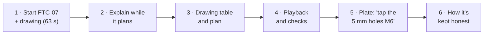

# Demo script

A walkthrough of about four minutes, plus answers to the questions most likely to come up. The times are from live runs, and every claim here is backed by a test or a recorded run in the other docs.

## Before you start

```bash
uv run --env-file .env uvicorn hole_cam.api:app     # http://127.0.0.1:8000
```

- Open the page once and plan the mixed plate, so you know the key and network work. That costs about $0.03.
- Have these files ready to pick: `fixtures/nist/nist_ftc_07_asme1_rd.stp` and `.pdf`, and `fixtures/parts/mixed.step`.
- Fallback if the network or API fails: the GIF at the top of the README is a recording of the FTC-07 run.
- Cost of the whole demo: about $0.25 (FTC-07 with its drawing $0.17, the plate $0.03, one revision $0.04).

## The walkthrough



**1. Start the slow run first (0:00).** Upload FTC-07's STEP file and its PDF drawing, material 6061, and click Plan. It takes about a minute, so start it before you talk.

> "This is a real part from NIST, an open box with holes on bosses inside it, and its real drawing. The drawing's dimensions are drawn as lines, with no text to search, so Claude has to read them off the page."

**2. While it plans (0:15–1:00), explain the split.**

> "A programmer turning a CAD model into a drilling program spends time on repetitive work: find every hole, pick the drill, decide on pecking, set speeds and feeds. Small slips there break tools or crash spindles. So the rule here is: Claude makes the judgment calls, which operations, which tools, in what order, and why. Anything that can break a tool if it's wrong is plain, tested code: the geometry, speeds and feeds, the G-code itself, and the safety checks. Claude's plan is a proposal. A schema fixes its format, code validates it, and the final program is checked before you can download it."

**3. The drawing and the plan (1:00).** Scroll to **From the drawing**.

> "Claude read six hole callouts for this setup and left out the ones for holes on the sides. It only transcribes. Code converts to mm and decides what each hole needs. These eight are +.003 inch. A drill can cut up to 0.1 mm oversize, and that's tighter, so code says ream them. The plan drills them 6.0 mm and reams them with a quarter-inch reamer."

Point at a reason line under an operation: every operation has one sentence a machinist can check.

**4. Playback and checks (1:45).** Let the playback run, or drag to the reamer near the end.

> "This isn't an animation of the plan. It's the G-code read back, move by move, so it shows what the machine will actually do. The line being run is highlighted. Six safety checks ran on this program: rapids into the part, spindle off while cutting, tool length offsets, machine limits, drilling too deep and an unsafe end. Download is blocked if any fail."

**5. Change the plan in plain English (2:30).** Plan `mixed.step` (about 15 s). Then type **"Tap the 5 mm holes M6 and the 6.8 mm holes M8."** and click Revise (about 10 s).

> "Claude added both tap operations, noticed the drills are already the right tap drills, and warned that one blind hole is only 5 mm deep, so it only gets two or three full threads. Code set the tap's feed as rpm times pitch. It's never a table value, because a tap that feeds out of step strips the thread or snaps."

Play to a tap: it backs out with the spindle reversed. Optional: try "Skip spot drilling to save time". Claude declines, explains why, and offers a cheaper change that is allowed.

**6. How it's kept honest (3:15).**

> "Three layers sit between Claude and a machine: the schema, the validator and the safety checks. As a second opinion, I ran the programs through LinuxCNC's own interpreter. Its first run caught two real portability bugs in my G-code. Now ten programs pass, with every move matching. 147 automated tests, and live runs on four real NIST parts. And an eval: it plans seven parts three times each per model and scores every run against drawing answers I wrote by hand. That showed something the checks can't: Haiku missed tolerance callouts on a drawing and still passed every check. A valid, safe program can still be the wrong program. What isn't done yet: nothing has run on a real machine, and the speeds and feeds are conservative starting values, not checked against a tool maker's chart."

## Likely questions

**What if Claude is wrong?**
It has been, and the layers caught it. In the eval, a quarter to a third of first plans were rejected by validation, and the retry with the errors listed fixed every one. Claude can't name a tool that doesn't exist (the schema), can't skip spotting or pecking (the validator), and never provides speeds or feeds. One more thing worth saying: on FTC-10 it gave a wrong *reason* for leaving holes out, even though leaving them out was right. The reason text isn't validated, so it's for a person to read critically.

**What does it cost, and how fast is it?**
About $0.03 and 10–15 s for a simple part, about $0.10 for a 16-hole real part, and $0.12–0.25 with a drawing (37–95 s). That's measured, with tokens recorded, in `docs/AI-IN-HOLE-CAM.md`.

**How do you know a prompt or model change didn't make it worse?**
`scripts/eval.py` re-runs the planner on seven parts, several times per model setting, and prints a scorecard: valid first try, valid after the retry, passed the checks, drawing callouts found, same plan each run, cost and time. The last sweep cost $3.29 for 63 plans. It found that Sonnet 5.5 matched Opus at 41% of the cost and half the time. I haven't switched yet: three runs per part only shows big differences, so a five-run sweep comes first.

**Why not just rules?**
For holes alone, rules could produce most plans, and comparing the two is on the next-steps list. Where the model earned its place in these runs: reading drawings with no text layer, recognizing counterbores from coaxial holes, noticing that 6.8 and 5.0 mm are tap-drill sizes, flagging a thread class meant for external threads, and taking plain-English changes. The rules still exist. They're in the validator.

**Would this work on our machines?**
The output is Fanuc-style, and it's been read by LinuxCNC's interpreter. A real shop needs a post-processor per machine, measured tool lengths, its own tool library and its own speeds and feeds. Those are data files and one module, not a rewrite.

**What would you do next week?**
Prove a program out on a real machine with a machinist. Run a five-run eval to decide on Sonnet, then cache the prompt and drawing and measure the saving with the same eval. Log the edits programmers make to generated plans, since that's the best test data for the prompt and the validator. Then let drawing tolerances choose drills: today a drill must match the model within 0.02 mm, even when a nearby drill lands inside the tolerance.

**How was it built?**
Over a weekend, with Claude Code as a pair programmer. Each stage got its tests before the next began, and the AI's code was checked the same way the AI's plans are. Live runs and real parts found bugs the tests didn't, and each one is written up in `docs/REAL-PARTS.md`.
