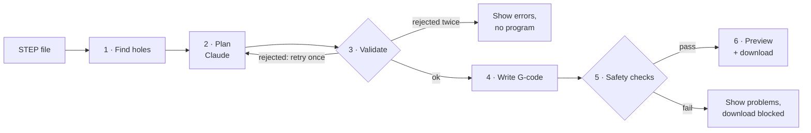
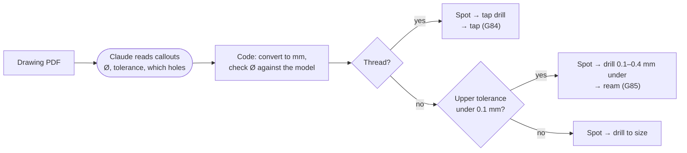
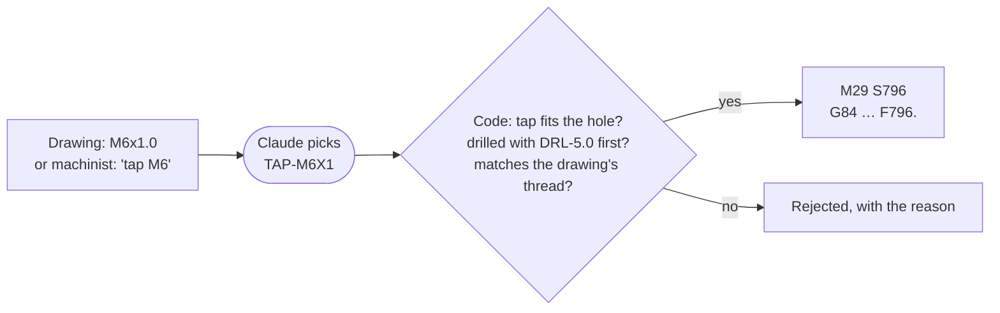
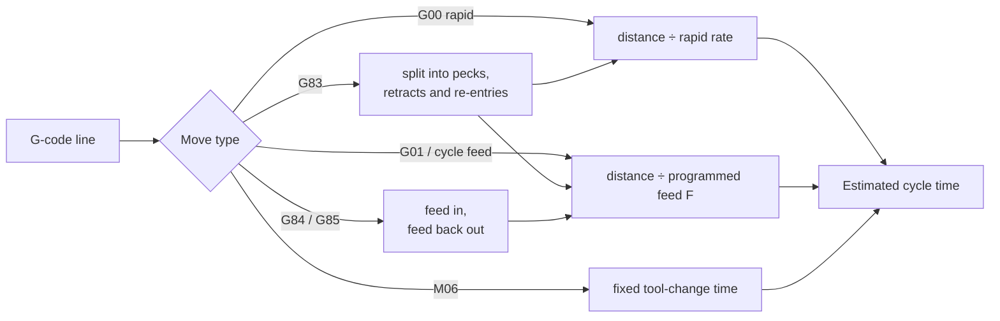
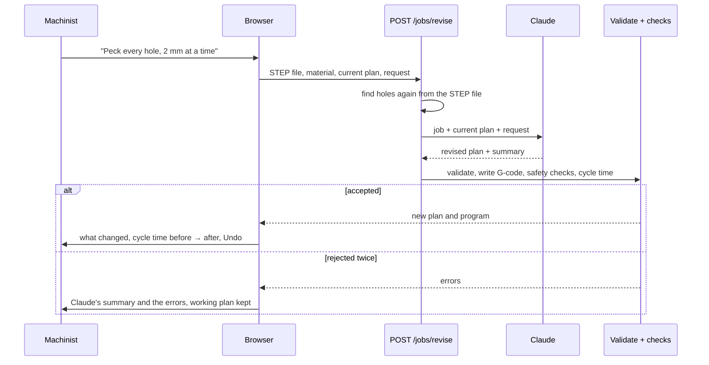
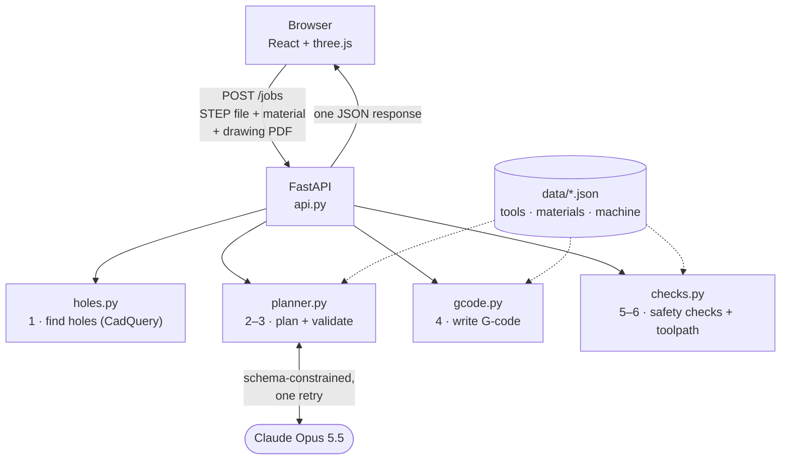

# How Hole-CAM works

Hole-CAM takes a 3D model of a machined part and produces a CNC program that drills its holes. It finds the holes in the model, has Claude decide how to drill them, writes the program with ordinary code, and then reads the finished program back to check it can't crash the machine. A program that fails any check can't be downloaded.

The scope is deliberately small: round holes drilled straight down from the top, in one setup, on a 3-axis vertical mill.



Each stage hands a plain data structure to the next one. Only stage 2 uses AI.

---

## 1. Finding the holes

**Input:** a STEP file, the standard format for exchanging 3D CAD models between programs.
**Output:** a list of holes, each with a position, diameter, depth and type (through or blind), plus the part's top and bottom heights.

The model is loaded with CadQuery, which is built on the OpenCascade CAD kernel. A hole is recognised from its geometry:

- **Cylindrical faces only.** Every round hole has an inside wall that is a cylinder.
- **Inside walls, not outside ones.** A raised round boss also has a cylindrical face, but its surface faces outward. The code checks which way each surface faces and keeps only the inward-facing ones.
- **All the way around.** The rounded inside corner of a pocket, the end of a slot and the lobe of a keyhole are inward-facing cylinders too, but only part of a circle. A hole's faces must cover the full 360°. On a real NIST part, this cut the count from 70 "holes" to the 20 on its drawing.
- **Split faces are merged.** CAD programs often store one hole as two half-cylinders. Faces that share an axis and radius are joined back into one hole.

**Choosing the setup.** A CAD model isn't always drawn with the side to drill facing up; real parts are often modeled on their side. Hole-CAM counts the holes along each axis, then tries both faces along the axis with the most. It picks the face that gives the most drillable holes and turns the part so that face is up. It also moves the part so its front-left corner is at X0 Y0, whatever the CAD file's own origin was. Then:
- **Vertical holes only.** Holes on the other sides can't be drilled in this setup. They're reported as *skipped: on another side*.
- **Opening upward.** A hole drilled up from the underside is also skipped. It's recognised because its top end is closed.

**Through or blind** is decided by what's at the bottom of the hole:
- If the bottom edge opens onto the part's underside, it's a **through** hole.
- If it's closed by a flat floor facing up into the hole, or by a cone (the point left by a drill), it's a **blind** hole.

**Depth** runs from the hole's own top surface down to the end of its full diameter. A drill-point cone at the bottom isn't counted, which matches how drawings dimension hole depth.

**Coordinates:** everything later uses the machine's convention for this setup. X0 Y0 is the part's front-left corner, and Z0 is the highest point of the part. So every point inside the part has a negative Z.

---

## 2. Planning the job (Claude)

**Input:** the hole list, the material, the tool library and the machine's limits, and optionally the part's drawing as a PDF.
**Output:** an ordered list of operations, each naming a tool, a cycle, the holes it covers and a one-sentence reason, plus any warnings and the hole callouts read from the drawing.

This is the only stage that uses AI, because it's the one that calls for judgment. Claude (Opus 5.5) is asked to:

- **Spot drill every hole first.** A short, stiff spot drill makes a small cone that keeps the drill from wandering off position. Claude sets the spot depth so the cone is a little smaller than the drill that follows.
- **Match each hole to a drill of the same diameter.** If no drill fits, it leaves the hole out and says what it would need, such as a reamer or a boring bar.
- **Peck drill deep holes.** Past 3× the hole's diameter, chips pack into the drill's flutes, so the drill is pulled out regularly to clear them (cycle G83). Shallower holes are drilled in one pass (cycle G81).
- **Group holes by tool** to keep tool changes down, and **explain each choice** in terms a machinist can check.
- **Tap a hole only when asked:** when the drawing calls out a thread, or the machinist asks for one ([Tapping](#tapping)).
- **Read the drawing**, when there is one (see below).

Claude is never asked for spindle speeds or feed rates. A wrong number there breaks tools, so those come from a table in stage 4.

The reply is constrained in two ways:
- **A JSON schema (structured outputs):** the reply must be valid JSON in exactly the plan's format.
- **Tool IDs limited to the real library:** the schema only allows tool names that exist, so Claude can't invent a drill.

Claude can also add warnings nobody asked for. On the test plate, it noticed that 6.8 mm and 5.0 mm are the standard drill sizes for M8 and M6 threads, and warned that tapping might be missing from the job. Asking "Tap the 5 mm holes M6 and the 6.8 mm holes M8" now adds it.

### Reading the drawing

A STEP model has the shape but not the tolerances. Those are on the drawing, often only as lines and symbols with no searchable text, as on the NIST drawings. So Claude reads the PDF itself:
- **What it returns:** each hole callout as written (for example `4X Ø.250 +.003 -.001`), the hole ids it points at, its units, the nominal size, and the upper and lower deviations. For a thread (`M3x0.5-6g`, `1/4-20 UNC-2B`) it returns the pitch, or threads per inch, instead of deviations.
- **How it matches callouts to holes:** by size, count and where the leader line points in each view. Callouts for holes not in this setup, such as holes on the sides, are left out.
- **What code decides from it:** the sizes are converted to mm by code, not by Claude. Then code decides what each hole needs. A twist drill can cut up to 0.1 mm oversize (`drill_oversize` in `data/machine.json`), so a hole whose upper tolerance is tighter than that is **reamed**: drilled 0.1 to 0.4 mm under size, then finished with a reamer of the exact size. A reamer cuts on its sides, so it is fed in and back out (cycle `G85`) rather than pulled out fast, which would scratch the wall. A thread callout means the hole is **tapped**.

The page shows the callouts in a **From the drawing** table, with what each hole needs. On NIST part FTC-07, Claude read the six callouts for holes in this setup and left out the four for holes on the sides. The 8 Ø.250 holes are toleranced +.003", so they're reamed. The Ø.281 holes (+.006") and Ø.438 counterbores (±.010") are drilled. On FTC-10, Claude found three `2X M3x0.5-6g` callouts on page 4 of five, so those six holes are drilled 2.5 mm and tapped M3.



### Tapping

A tap cuts a thread into a drilled hole. The hole is drilled first with the tap's **tap drill**, a size made for that thread (5.0 mm for M6, #7 for 1/4-20). The library has 14 common taps, M3 to M12 and #8-32 to 1/2-13, each linked to its tap drill.

Claude decides which holes get threads, and only when the drawing calls one out or the machinist asks for one. A 5 mm hole could be a plain hole or an M6 thread; the model alone doesn't say. Code checks everything else:
- **Which taps fit a hole.** CAD models a threaded hole anywhere from the thread's minor diameter to its full size. FTC-10's M3 holes are 2.46 mm, the M3 minor diameter, not the 2.5 mm tap drill. So a tap fits a hole between its minor diameter and its thread size.
- **The drill.** It must be the tap's own tap drill, even when the model shows the hole at full thread size.
- **The cycle and feed.** Rigid tapping, Fanuc style: `M29 S…` locks the feed to the spindle, then `G84` feeds in, reverses the spindle and feeds back out. A tap must advance exactly one thread per turn, so the feed is rpm × pitch, never a table value. If that would pass the machine's feed limit, the spindle slows instead.



---

## 3. Validating the plan

**Input:** Claude's plan (including what it read off the drawing) and the hole list.
**Output:** a list of errors. If it's empty, the plan can be used.

Plain code checks every plan, because a well-formatted plan can still be wrong. It rejects a plan if:

- a tool can't do the operation (for example, a spot drill used to drill a hole)
- a drill's diameter doesn't match its hole (within 0.02 mm), unless the hole is reamed afterwards, or is tapped and this is its tap drill
- a drawing callout's size doesn't match the model's size for the holes it points at, it lists more holes than its count (4X), or a hole has two callouts. The callout is on the wrong hole, or the drawing and model disagree; either way a person should look.
- a hole the drawing tolerances tighter than a drill holds is drilled to size, or not reamed when the library has the reamer and pre-drill for it
- a hole is reamed before it's drilled, or its pre-drill leaves less than 0.1 or more than 0.4 mm for the reamer
- a reaming operation doesn't use `G85`, or a drilling one does
- a tap doesn't fit its hole, or doesn't make the thread the drawing calls out
- a hole is tapped before it's drilled, or was drilled with something other than its tap's tap drill
- a hole the drawing threads isn't tapped, when the library has the tap
- a tapping operation doesn't use `G84`, or another one does
- a hole is drilled before it's spotted. A hole that starts at the floor of a wider hole already drilled counts as spotted, because the wider drill's point leaves a centered cone.
- a hole under a counterbore deeper than the R-plane clearance is spotted or drilled before the counterbore is cut. Until then, the rapid down to its R plane would end inside the part.
- a hole is drilled twice, or skipped even though a drill fits it
- a drill's flutes are too short for the depth it has to reach
- a hole deeper than 3× its diameter isn't peck drilled, or a peck cycle has no peck depth
- a spot drill would make a cone much wider than the hole
- an operation refers to a hole that doesn't exist.

If a plan fails, the errors go back to Claude once and it returns a corrected plan. If that one fails too, no program is written and the errors are shown.

---

## 4. Writing the G-code

**Input:** the validated plan, the hole list, and the tool, material and machine data.
**Output:** a program in G-code, the language CNC machines run, in the common Fanuc style.

This stage makes no decisions. It does arithmetic and formatting.

### Structure of the program

```
%
O1000 (MIXED)                          program number and name
G21 G90 G17 G40 G49 G80                millimetres, absolute coordinates, XY plane, clear leftover offsets and cycles
G54                                    use the work origin (front-left corner, top of the part)
T1 M06 (SPOT DRILL 10MM 90DEG)         load tool 1
G00 G43 H1 Z25. S2387 M03              apply tool 1's length offset, rapid to 25 mm above the part, spindle on at 2387 rpm
M08                                    coolant on
G00 X15. Y15.                          rapid over the first hole
G98 G81 X15. Y15. Z-1.5 R2. F119.      drilling cycle: rapid to 2 mm above the surface, feed to depth, return to start height
X35. Y45. Z-1.5 R2.                    the same cycle at the next hole
...
G80                                    cancel the cycle
M09 / M05                              coolant off, spindle off
G91 G28 Z0. / G90                      send Z home before the next tool
...
M30                                    end of program
%
```

`G00` is written out on the tool-length-offset line rather than assumed from earlier. LinuxCNC rejects the line without it, and some Fanuc controls start up in feed mode. Running the programs through LinuxCNC's interpreter found this, along with a tool comment that had parentheses inside parentheses. A Fanuc ends a comment at the first `)`, which would leave a stray `)` on the line. Comments are now cleaned of anything but letters, numbers and a few safe symbols.

### Where the numbers come from

- **Spindle speed:** rpm = cutting speed × 1000 / (π × tool diameter). In 6061 aluminum the table gives 75 m/min, so a 10 mm spot drill runs at 2387 rpm. Reamers have their own, slower cutting speed (40 m/min in 6061) and a larger feed per revolution, and taps are slowest (15 m/min). Speed is capped at the machine's maximum.
- **Feed rate:** feed (mm/min) = rpm × feed per revolution. Feed per revolution comes from the material table and grows with drill diameter. For a tap it's the thread pitch: an M8 tap at 597 rpm feeds 597 × 1.25 = 746.25 mm/min.
- **Drilling depth:** a drill's tip is a cone, so it has to go deeper than the hole to make the full diameter reach the bottom. For a 118° drill, that extra length is (diameter / 2) / tan(59°), about 1.5 mm on a 5 mm drill. Through holes go another 1 mm so the drill breaks out cleanly. A reamer goes to the hole's depth; its short lead chamfer is ignored. A tap goes through a through hole until its 3-thread lead is out the bottom, and stops one thread short of a blind hole's bottom. The thread depth on the drawing isn't read.
- **Hole order:** within each operation, the next hole is always the nearest one not yet drilled, starting from the corner.
- **Tool changes:** when two operations in a row use the same tool (for example, plain drilling then peck drilling with the 5 mm drill), it stays loaded and there's no trip home in between.

The tool library, material table and machine limits are plain JSON files in `data/`. The speeds and feeds there are conservative starting values for cobalt drills and haven't been checked against a drill maker's chart.

---

## 5. Safety checks

**Input:** the finished G-code, plus the part's surface heights and bottom height.
**Output:** a list of problems, each with a line number and a plain-language explanation.

The checker reads the program the way a machine would, one line at a time, and keeps track of the machine's state:
- which tool is loaded, and whether its length offset is active
- whether the spindle is running
- which drilling cycle is active, with its depth and R height
- where the tool is.

It runs six checks, one for each classic way a program crashes a machine or breaks a tool:

| Check | What it catches | Why it matters |
|---|---|---|
| Rapid into the part | A full-speed move below the top of the part, other than straight down into a known hole | The tool hits the part at full speed |
| Spindle off while cutting | A feed move or drilling cycle with the spindle stopped | The tool snaps |
| Tool length offset | A Z move after a tool change with no offset, or the offset of a different tool | The machine doesn't know how long the tool is, so every height is wrong |
| Machine limits | Speed or feed above the machine's maximum | The machine alarms, or the tool fails |
| Too deep | Drilling more than 5 mm below the bottom of the part | The drill goes into the fixture or table |
| Unsafe end | A drilling cycle still active at a tool change, going home or the end; or no end-of-program code | Any later X/Y move would drill an extra hole |

The checker knows each hole's surface height from stage 1, so a correct move below the top of the part, into a hole on a lower face, isn't reported as a problem. The checks look only at the program, not at how it was made, so they work on programs from any source.

If any check fails, the program can't be downloaded.

**How well it works:** on a set of 20 programs, 18 with one deliberately planted problem and 2 clean, the checker caught all 18 with no false alarms. Each bad program had to trip exactly its planted check and nothing else.

### A second opinion: LinuxCNC's interpreter

The checker and the preview both read the program with this project's own G-code reader. If that reader misunderstood a cycle the same way the writer did, nothing above would notice. So `scripts/linuxcnc_check.py` runs the program through `rs274`, the interpreter real LinuxCNC machines use, in Docker, and checks three things:
1. LinuxCNC reads the whole program without an error.
2. Its moves match the toolpath our checker traced, move for move.
3. What its moves cut matches the plan. Every planned hole is cut to size and depth, nothing is cut anywhere else, and each tap reaches its depth without hitting the bottom, at exactly one pitch per turn.

Two control differences are allowed for. LinuxCNC has no `M29`, so that line is dropped. And on the way out of a `G84` or `G85` hole under `G98`, Fanuc feeds to R and then rapids up while LinuxCNC feeds all the way, so those count as one move. For the move comparison, the peck re-entry gap is set to LinuxCNC's fixed 0.254 mm.

All ten programs tried pass, from 15 to 289 moves each ([REAL-PARTS.md](REAL-PARTS.md#proving-the-programs-out-on-linuxcnc)). It catches what it should: removing the ream operation, swapping in the wrong drill, changing a tap's feed or driving a tap into the bottom each make it fail.

```bash
uv run python scripts/linuxcnc_check.py fixtures/parts/mixed.step fixtures/plans/mixed.json 6061   # needs Docker
```

---

## 6. The preview

The page shows the part in 3D with the toolpath drawn over it:
- **The part** is converted into triangles and shifted so its coordinates match the program's (Z0 on top).
- **The toolpath** is drawn from the finished G-code, not from the plan, using the safety checker's record of every move. So the picture shows what the machine will actually do.
- **Dashed lines are rapid moves and solid lines are cutting,** in one color per tool, matching the colors in the plan list. Cutting lines are drawn on top so they stay visible inside the part.

### The simulated run and cycle time

The view also plays the program back like a simple machine simulator. It starts by itself, or waits for Play if the computer is set to reduce motion.
- **The tool:** a model of each drill in its holder moves through every move. It's built from the tool library: two spiral flutes at the drill's real diameter and flute length, ground to its real point angle, spinning while the program runs. The collet nut holding it is in the tool's color from the plan list. Peck cycles (`G83`) are played out in full: down one peck, back out to the R plane to clear chips, down again. A reamer has six straight flutes and feeds back out of the hole (`G85`). A tap has four straight flutes and a thread at its real pitch. It feeds in, then backs out with the spindle turning the other way (`G84`).
- **The holes:** each hole fills in with the drill's color as the drill feeds down through it. Spot drilling doesn't count, since it only marks the start.
- **The current step:** a card in the corner of the view says in plain words what the machine is doing ("Drilling hole 4 · peck 2 of 5", "Pulling out to clear chips", "Tool change: T8 · 6.8 mm drill"), with the tool and the G-code line being run. The same line is highlighted in the G-code listing, which scrolls to follow it.
- **The controls:** play/pause, a slider to jump to any moment, and speeds from 0.1× to 5×. It plays at 1×, real machine time, by default. The slower speeds help follow the rapids, which take about a tenth of a second between holes.
- **Tool changes:** the tool disappears for the length of a change, and the step card says which tool is going in.

The timing comes from the same record of moves the safety checker builds. The checker already follows the program line by line, so it also times each move and expands each peck cycle into its separate moves:



The total is shown under the safety checks as **Estimated cycle time**, with the number of tool changes. For the mixed test plate it comes to about 32 seconds: 12 s of tool changes, 17 s of cutting and 3 s of rapids.

It's an estimate:
- The rapid rate (24 m/min), tool change time (4 s) and peck re-entry gap (1 mm) are typical values in `data/machine.json`, not measured on a real machine.
- Rapids are timed as straight lines at full speed, with no acceleration. Real machines take longer on short moves.
- Trips to the home position (`G28`) aren't timed.

---

## 7. Changing the plan in plain English (Claude)

Under the plan, a machinist can type a change the way they'd say it to a programmer: "do the deep holes first", "peck every hole, 2 mm at a time", "we can't skip spot drilling?". A few example requests are one click away.

Claude gets the job, the current plan and the request. It returns a revised plan plus a one- or two-sentence summary of what it changed, or why it couldn't. The revised plan then goes through exactly the same steps as a new one: validation (with one retry), G-code, safety checks, cycle time and playback.



Claude is told which rules the code enforces, so it keeps them even when asked not to:
- every drilled hole is spotted first
- each drill matches its hole's diameter, and tools come from the library
- holes deeper than 3× their diameter are peck drilled
- the drill's flutes reach the full depth
- every hole the library can drill is drilled.

Everything else is a default the machinist can override: peck size, pecking shallow holes, spot depth, order and grouping.

The page then shows:
- the request and Claude's summary
- the operations removed (struck through) and added, or "same operations in a new order"
- cycle time and tool changes before → after, and whether the safety checks pass
- an **Undo** button that puts the previous plan back.

If the revision is rejected, the working plan and its program stay as they were. The page shows what Claude tried and why it was rejected.

The page sends the STEP file again with each request instead of the hole list. The hole geometry drives every depth in the G-code, so the server measures it itself rather than trusting the browser. The current plan is sent only as context for Claude, and the revised plan is validated like any other.

---

## How the pieces connect

The web page sends the STEP file, material and optional drawing PDF to `POST /jobs`, or to `POST /jobs/revise` with the current plan and a requested change. The server runs all six stages and returns everything in one response:
- the holes and skipped holes
- the plan, or the reasons it was rejected
- the drawing callouts, in mm, with which holes need reaming or tapping
- the G-code and the safety check results
- the part mesh, the timed toolpath and the estimated cycle time
- whether the program may be downloaded
- for a revision, Claude's summary of the change.

Nothing is stored between requests.



---

## Where the AI is trusted, and where it isn't

| Decided by Claude | Decided by plain code |
|---|---|
| Which operations, in what order | Finding holes and measuring them |
| Reading the drawing's hole callouts | Converting them to mm, and whether a hole must be reamed or tapped |
| Which holes to tap, when asked | Whether the tap fits, its drill, and its feed |
| Which tool for each hole | Spindle speeds and feed rates |
| When to peck drill | Every number in the G-code |
| Explaining each choice | Whether the plan is acceptable |
| Spotting things worth a warning | Whether the program is safe to run |
| Applying a machinist's requested change, or explaining why it can't | Which rules a change may not break |

Claude's output passes through three layers before anything can reach a machine:
1. **The schema** fixes the format and the list of real tools.
2. **Validation** catches bad machining choices.
3. **The safety checks** catch anything unsafe in the final program, including bugs in the G-code writer itself.

The full details, including the exact prompt, schema, request settings, measured cost and timing, and real responses, are in [AI-IN-HOLE-CAM.md](AI-IN-HOLE-CAM.md).

---

## Glossary

Short definitions. For fuller, plain-language explanations, see [MANUFACTURING-PRIMER.md](MANUFACTURING-PRIMER.md).

| Term | Meaning |
|---|---|
| **STEP** | Standard file format for 3D CAD models |
| **G-code** | The instruction language CNC machines run. G codes are motions and modes; M codes switch things like the spindle and coolant. |
| **Work offset (G54)** | Where the program's zero point is on the part |
| **Tool length offset (G43 H)** | Each tool's measured length, so the machine knows where its tip is |
| **Rapid (G00) and feed (G01)** | Rapid is the machine's top speed, for moving through air. Feed is the controlled speed used for cutting. |
| **Spot drill** | A short, stiff tool that makes a small starting cone so a drill doesn't wander |
| **Plain drilling (G81)** | Feed to depth in one go, then retract |
| **Peck drilling (G83)** | Drill in steps, pulling out between them to clear chips |
| **Reaming (G85)** | Finishing a slightly undersized drilled hole to an exact size with a reamer, feeding in and back out |
| **Tapping (G84)** | Cutting a thread in a drilled hole: feed in, reverse the spindle, feed out. Rigid tapping (`M29`) locks the feed to the spindle. |
| **Thread callout** | A thread's size and pitch on the drawing, for example `M6x1.0-6H` (6 mm, 1 mm per turn) or `1/4-20 UNC` (20 threads per inch) |
| **Tolerance callout** | The size and allowed variation of a feature on the drawing, for example `Ø.250 +.003 -.000`: 0.250" to 0.253" |
| **R plane** | The height just above the surface where a drilling cycle switches from rapid to feed |
| **G98 / G99** | After each hole, return to the starting height (G98) or only to the R plane (G99) |
| **Through / blind hole** | A through hole goes all the way through the part; a blind hole has a bottom |
| **3×D (or 3xD)** | Depth measured in hole diameters. A 15 mm deep, 5 mm hole is 3×D. |
| **Breakthrough** | Extra depth so a drill fully exits the bottom of a through hole |
| **Tap drill** | The drill size made for a particular thread, before tapping. For example, 6.8 mm for M8. |
| **Cutting speed / feed per revolution** | How fast the cutting edge moves through the material, and how far the drill advances per turn. Together they set rpm and feed rate. |

---

## What it doesn't do

- Holes only: no boring, thread milling, pockets, chamfers or profiles. Reaming and tapping only with the reamers and taps in the library.
- A thread's depth on the drawing isn't read: blind holes are tapped to one thread short of the bottom.
- One setup: the part is turned to whichever of its six sides has the most holes to drill, and holes on the other sides, or on angled faces, are skipped.
- Programs are metric and Fanuc-style only, though inch parts and inch drills work.
- Counterbored holes come out as two separate holes, one per diameter, drilled with a pointed drill. Claude warns when a flat floor is needed.
- Tool reach isn't checked: a hole deep inside a box needs a tool and holder long enough to reach it without hitting the walls.
- The rapid-move check looks at each move's start and end points, not the full path. Below the top of the part, it only knows surface heights at hole centers.
- The cycle time is an estimate from typical machine values, not a measured run.
- The speeds and feeds are unverified starting values, and the programs haven't been run on a machine, only through LinuxCNC's interpreter. Nothing it produces should run without a machinist's review.

---

## Where the code is

| Stage | File |
|---|---|
| 1. Find holes | `src/hole_cam/holes.py` |
| 2–3. Plan and validate | `src/hole_cam/planner.py` |
| 4. Write G-code | `src/hole_cam/gcode.py` |
| 5. Safety checks and toolpath | `src/hole_cam/checks.py` |
| Server | `src/hole_cam/api.py` |
| Web page | `web/src/App.tsx` and its panels (`Results.tsx`, `ChangePlan.tsx`); API calls in `api.ts` |
| 3D view and playback | `web/src/Viewer.tsx`; move timing and step text in `playback.ts`, tool models in `toolModel.ts` |
| Tools, materials, machine | `data/*.json` (read by `src/hole_cam/data.py`) |
| Test parts, plans, reference program, bad-program set | `fixtures/` |
| LinuxCNC prove-out | `scripts/linuxcnc_check.py` |
