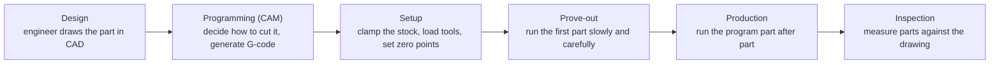
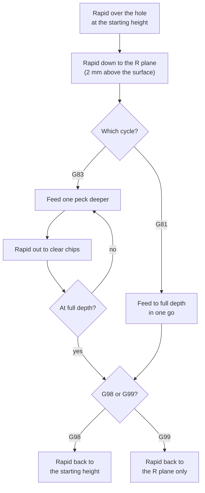

# Manufacturing primer

Plain-language notes on the manufacturing terms used around Hole-CAM, for someone who hasn't worked in a machine shop. It starts with how a machined part gets made, then covers the machine, holes, tools, cutting and G-code. It ends with shop-floor and business terms you'll hear around this kind of software.

Throughout, **"In Hole-CAM"** notes say where a term shows up in the app.

---

## 1. How a machined part gets made

Machining is *subtractive* manufacturing: you start with a solid block of metal (the **stock**) and cut material away until the part is left. 3D printing is the opposite, building a part up layer by layer.

The people involved:

| Role | What they do |
|---|---|
| **Design or manufacturing engineer** | Designs the part in CAD and makes the drawing that says what's acceptable |
| **CNC programmer** | Decides how the part will be cut and produces the program the machine runs |
| **Machinist or operator** | Sets up the machine, runs programs, watches for problems, measures parts |
| **Quality inspector** | Checks finished parts against the drawing |

**In Hole-CAM:** the app automates part of the programmer's job, for holes only. Its output still has to go through setup and prove-out like any other program.

---

## 2. Software and files

| Term | Meaning |
|---|---|
| **CAD** (computer-aided design) | Software for drawing parts in 3D, such as SolidWorks, Fusion, Onshape or FreeCAD |
| **STEP file** (`.step`, `.stp`) | A standard 3D model format that any CAD program can read and write. It's the usual way to send a model to someone using different software. |
| **Drawing** (or print) | A 2D document with the part's dimensions, tolerances and notes. In a shop, the drawing is the contract: a part is good if it matches the drawing. |
| **CAM** (computer-aided manufacturing) | Software that turns a 3D model into machine instructions. A programmer chooses tools and strategies, and the CAM software calculates the exact paths. |
| **Toolpath** | The path the tool's tip follows through the air and the material |
| **G-code** (or NC program, `.nc` file) | The text instructions a CNC machine executes, one line at a time (see section 7) |
| **Post-processor** | The part of a CAM system that writes G-code in the dialect a particular machine expects. Machines from different makers differ in small but important ways. |

**In Hole-CAM:** it reads a STEP file, does a narrow slice of CAM's job, and writes G-code. It has no post-processor. It writes one generic Fanuc-style dialect.

---

## 3. The machine

| Term | Meaning |
|---|---|
| **CNC** (computer numerical control) | A machine tool driven by a program instead of by hand |
| **Mill** (or milling machine) | A machine where a spinning tool cuts a part held still on a table. A **lathe** is the opposite: the part spins and the tool stays still. |
| **VMC** (vertical machining center) | A CNC mill with the spindle pointing straight down, and an automatic tool changer. It's the most common machine in job shops. |
| **Axes** (X, Y, Z) | The directions the machine can move. X is left–right, Y is front–back and Z is up–down. A **3-axis** machine moves only in these three directions, so it can only reach the part from above. |
| **Spindle** | The motor-driven shaft that holds and spins the tool |
| **Tool changer** | A carousel of tools the machine swaps automatically. Each slot has a number, and the program asks for tools by number (T1, T6). |
| **Controller** (or control) | The computer in the machine that reads G-code and drives the motors. **Fanuc** is the most widespread controller brand, and its G-code style is the de facto standard. |
| **Coolant** | Liquid sprayed at the cut to carry away heat and chips and help the tool last longer |
| **Machine home** | A fixed reference position, usually with the spindle fully up. Machines go there before tool changes. |
| **Workholding** (vise, fixture) | Whatever clamps the stock to the table. A **fixture** is custom workholding made for one part. |

**In Hole-CAM:** the target is a generic 3-axis VMC with a Fanuc-style controller. The machine's limits (top spindle speed, top feed rate) are in `data/machine.json`.

---

## 4. Setups and coordinates

**Setup:** each time a part is clamped in a new position, that's one setup. A 3-axis machine can only cut what it can reach from above, so features on the sides or bottom need the part flipped or re-clamped, which means more setups. Every setup costs time and is a chance to introduce error.

**Work offset** (or work coordinate system, **G54**): the program's zero point, set on the actual part during setup. A program says "drill at X15 Y15", and the work offset tells the machine where X0 Y0 is on the real part.

**Tool length offset** (**G43 H**): every tool sticks out of its holder by a different amount. Each tool's length is measured and stored, and the program turns that measurement on after loading the tool. Without it, the machine has no idea where the tool's tip is. If the wrong length is used, every height in the program is wrong by the difference, which is a classic way to crash a machine.

**Absolute and incremental coordinates** (**G90 / G91**): in absolute mode, a position is measured from the zero point. In incremental mode, it's measured from where the tool is now.

**In Hole-CAM:** X0 Y0 is the part's front-left corner and Z0 is the highest point of the part, so everything inside the part has a negative Z. It's one setup only: the part is turned so the side with the most holes to drill faces up, and holes on the other sides are *skipped*. The safety checks verify that the tool length offset is on and matches the loaded tool.

---

## 5. Holes

| Term | Meaning |
|---|---|
| **Ø** (diameter) | How wide a hole is. "Ø6.8" means 6.8 mm across. |
| **Through hole** | A hole that goes all the way through the part |
| **Blind hole** | A hole with a bottom |
| **Depth ratio (×D, or xD)** | Hole depth measured in diameters. A 20 mm deep, 5 mm hole is 4×D. Deeper ratios are harder to drill because chips struggle to get out. |
| **Drill point** | The cone-shaped tip of a drill, usually 118°. A drilled blind hole has a cone at its bottom, and the drill must go a little deeper than the hole's stated depth so the full diameter reaches it. |
| **Breakthrough** | Extra depth on a through hole so the drill's point fully exits the bottom and leaves a clean full-size hole |
| **Threaded (tapped) hole** | A hole with screw threads cut inside. It's made by drilling a smaller hole first, then cutting threads with a **tap**. |
| **Thread size** (M6, M8) | Metric thread notation. M8 is an 8 mm screw thread. |
| **Tap drill** | The drill size made for a thread. 6.8 mm is the tap drill for M8, and 5.0 mm for M6. |
| **Counterbore** | A wider, shallow step at the top of a hole, so a bolt head sits flush or below the surface |
| **Countersink** | A cone-shaped opening at the top of a hole, for a flat-head screw |
| **Reaming** | A finishing pass with a **reamer** that brings a drilled hole to a very accurate size and smooth finish |
| **Tolerance** | How far a dimension may vary and still be acceptable, for example 6.8 ± 0.1 mm |

**In Hole-CAM:** it finds round holes, measures diameter and depth, and labels each through or blind. Depth means the full-diameter depth, not counting the drill point. Claude noticed the test plate's 6.8 mm and 5.0 mm holes match the M8 and M6 tap drills and warned that tapping might be missing. A counterbore shows up as two separate holes.

---

## 6. Tools and cutting

### Tools

| Term | Meaning |
|---|---|
| **Twist drill** | The ordinary drill. Its spiral grooves are called **flutes**, and they carry chips up and out of the hole. |
| **Jobber drill** | The standard, general-purpose drill length |
| **Flute length** | How much of the drill can actually cut. A hole deeper than the flute length can't be drilled with that tool. |
| **Spot drill** | A short, stiff drill used to make a small starting cone. Long drills flex and can wander off position when starting on a flat surface, and the spot gives them a guide. |
| **HSS, cobalt, carbide** | Tool materials. HSS (high-speed steel) is cheap and tough. Cobalt HSS handles more heat. Carbide is much harder and cuts much faster, but it's brittle and more expensive. |
| **Tool library** | The list of tools the shop has available, with their sizes |

### Cutting

| Term | Meaning |
|---|---|
| **Chips** | The curls or flakes of metal cut off by the tool |
| **Cutting speed** (surface speed, m/min) | How fast the tool's cutting edge moves past the material. Each material and tool material has a safe range. Too fast and the tool overheats and wears out. |
| **Spindle speed** (rpm) | How fast the spindle turns. It comes from cutting speed: rpm = cutting speed × 1000 / (π × tool diameter). So bigger tools spin slower. |
| **Feed per revolution** (mm/rev) | How far the drill advances each turn, which sets how thick each chip is |
| **Feed rate** (mm/min) | How fast the tool advances: rpm × feed per revolution |
| **Peck drilling** | Drilling in short steps, pulling the drill out between them so chips can escape. Without it, chips pack into the flutes of a deep hole, heat builds up and the drill can snap. A common rule is to peck past 3×D. |
| **Cycle time** | How long the machine takes to make one part. Tool changes, trips home and air moves all add to it. |

**Worked example:** 6061 aluminum allows about 75 m/min with a cobalt drill. For a 10 mm tool, that's 75 × 1000 / (π × 10) = 2387 rpm. At 0.05 mm per revolution, the feed rate is 2387 × 0.05 = 119 mm/min.

### Materials in the app

| Material | What it is |
|---|---|
| **6061-T6 aluminum** | The most common machining aluminum. It's light, cuts easily and fast, but it's gummy and can stick to tools. "T6" is its heat treatment. |
| **1018 steel** | A common low-carbon ("mild") steel. It's strong and cheap, and cuts at roughly a third of aluminum's speed. |

**In Hole-CAM:** cutting speeds and feeds come from `data/materials.json`, never from Claude. The tool library is `data/tools.json`. The validator rejects a drill whose flute length is too short for the hole, and requires peck drilling past 3×D.

---

## 7. G-code

A G-code program is a list of lines. Each line is made of **words**: a letter followed by a number.

| Letter | Meaning |
|---|---|
| **G** | A motion or mode, such as move, drill, or units |
| **M** | A machine function, such as spindle, coolant, tool change or program end |
| **X, Y, Z** | A position |
| **T** | A tool number |
| **S** | Spindle speed (rpm) |
| **F** | Feed rate (mm/min) |
| **H** | Which tool length offset to use |
| **R, Q** | In drilling cycles: the R plane height, and the peck depth |

Most codes are **modal**: once set, they stay in effect until something changes them. That's why a forgotten "cancel" code is dangerous: the old mode carries on into lines that weren't written for it.

### The codes Hole-CAM uses

| Code | Meaning |
|---|---|
| `G00` | **Rapid:** move at full speed, through air only |
| `G01` | **Feed:** move at the programmed cutting speed |
| `G21` | Units are millimetres |
| `G90` / `G91` | Absolute or incremental coordinates |
| `G54` | Use work offset 1 (the part's zero point) |
| `G43 H_` | Turn on the tool length offset |
| `G49` | Cancel the tool length offset |
| `G81` | Drilling cycle: drill to depth in one go |
| `G83` | Peck drilling cycle |
| `G80` | Cancel the drilling cycle |
| `G98` / `G99` | After each hole, return to the starting height (G98) or only to the R plane (G99) |
| `G28` | Go to machine home |
| `T_ M06` | Change to tool number _ |
| `M03` / `M05` | Spindle on (clockwise) or off |
| `M08` / `M09` | Coolant on or off |
| `M30` | End of program |

### What a drilling cycle does

One cycle line (`G81` or `G83`) drills a hole, and each following line with just X and Y drills another hole the same way. The **R plane** is a height just above the surface where the tool stops rapid-moving and starts cutting.

G99 is faster because the tool doesn't climb as high between holes. But if anything taller sits between two holes, the tool runs straight into it. That's why Hole-CAM uses G98.

**In Hole-CAM:** section 4 of `docs/HOW-IT-WORKS.md` walks through a real program line by line.

---

## 8. On the shop floor

| Term | Meaning |
|---|---|
| **Crash** | The tool or spindle hits something it shouldn't: the part, the vise or the table. It can cost a broken tool, a scrapped part, or a spindle repair worth tens of thousands. |
| **Scrap** | A part that's out of tolerance and can't be used |
| **Prove-out** | Running a new program for the first time, carefully. Operators often run **single block** (one line at a time) and turn the **feed and rapid overrides** down to slow everything. |
| **First article** | The first part made by a new program or setup, measured in detail before production continues |
| **Setup sheet** | Instructions for the operator: how to clamp the part, where zero is, which tools go where |
| **Air cutting** | The tool moving through air where it thinks there's material, often because an offset is wrong. It wastes time and signals that something is off. |

**In Hole-CAM:** the six safety checks target the most common causes of crashes and broken tools. The checks don't replace prove-out, they just catch problems earlier.

---

## 9. Terms you'll hear around the job

These aren't used inside Hole-CAM, but they come up around manufacturing software, and several are in the Re:CAM job description.

| Term | Meaning |
|---|---|
| **MES** (manufacturing execution system) | Software that runs the shop floor: which jobs run on which machines, what's been made, who did it, and quality records |
| **ERP** (enterprise resource planning) | Business software for orders, inventory, purchasing and accounting. The MES handles the floor; the ERP handles the business. |
| **Work order** | An instruction to make a quantity of a part by a date |
| **Routing** | The ordered list of steps a part goes through, such as saw, mill, drill, deburr, inspect |
| **Quoting** | Estimating cost and lead time for a customer's part, often from a STEP file and drawing |
| **OEE** (overall equipment effectiveness) | A standard score for how productive a machine is: availability × performance × quality |
| **MTConnect** | An open standard for reading live data from machines, such as whether they're running, spindle speed and alarms |
| **GD&T** (geometric dimensioning and tolerancing) | A symbol language on drawings that defines allowed variation in form and position, such as how true a hole's position must be |
| **CMM** (coordinate measuring machine) | A precise probe-based measuring machine used for inspection |
| **Job shop** | A shop that makes many different parts in small batches for different customers, as opposed to a production line |
