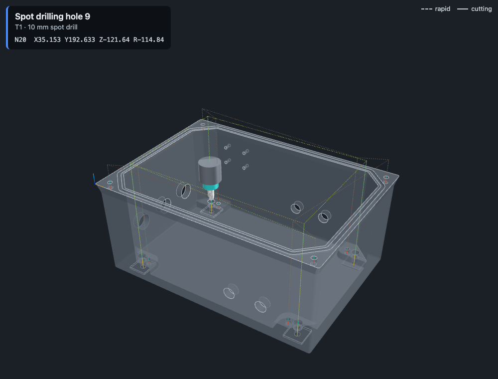

# Hole-CAM on real parts

Until this test, every part Hole-CAM had seen was one I generated, built the way the code expects. Real parts are the first thing a customer brings. So I ran the app on 11 real CAD parts from NIST, checked the results against each part's engineering drawing, and fixed what broke.

---

## The parts

NIST publishes test parts for its model-based manufacturing project: STEP files exported from several CAD systems, each with a fully dimensioned drawing. NIST says they can be used without restriction. I used the 11 "geometry only" files from [NIST's download page](https://www.nist.gov/el/systems-integration-division-73400/mbe-pmi-validation-and-conformance-testing/download-free-cad).

They aren't friendly test cases:
- Most are **inch** parts, with letter and number drill sizes (for example .238" is a "B" drill, .213" is a "#3").
- Several are **modeled on their side or upside down**, so the face to drill isn't the top in the CAD file.
- They have **pockets with rounded corners, slots, keyholes and counterbores**: shapes with curved walls that aren't simple drilled holes.

---

## What broke

The first run turned up three bugs and two gaps. All five are now fixed and tested.

| Problem | What happened | Fix |
|---|---|---|
| **Rounded corners counted as holes** | FTC-08 has 20 holes on its drawing, but Hole-CAM found 70. The inside corners of pockets, the ends of slots and the lobes of keyholes are all curved walls, and the code accepted any inward-facing curved wall as a hole. | A hole must go all the way around (360°). FTC-08 now finds exactly the 20 holes on the drawing. |
| **Parts modeled on their side** | FTC-09 is a 3 mm plate standing on edge in its CAD file. All 29 of its holes were "not vertical", so none were found. | The part is turned so the side with the most drillable holes faces up. FTC-09 now finds 29 holes from its −Y side. |
| **Program zero in the wrong place** | The G-code assumes X0 Y0 is the part's front-left corner, but hole positions came straight from the CAD file's own origin. All 11 NIST parts extend into negative X, and most are modeled around their center. CTC-01 runs from X−590 to X+580 mm, so its program would have put holes up to 590 mm from where they belong. | The part is moved so its front-left corner is at X0 Y0, and the 3D view uses the same turned and moved part. |
| **No inch drills** | The tool library was metric only, so most holes on US parts had no drill. It was also missing 2.5 mm, the tap drill for M3, the most common metric thread. | Added a standard US set: fractional drills from 1/8" to 1/2" by 32nds, and the number and letter tap drills for common threads. I didn't add sizes just to match these parts. |
| **Drill size matching too loose** | With inch drills in the library, a 9/32" drill (7.144 mm) counted as a match for a 7.1 mm hole, because the match tolerance was 0.05 mm. | Tightened to 0.02 mm: enough for inch-to-mm rounding (every NIST hole matches its nominal drill within 0.01 mm), but no longer accepting a different size. |

Each fix has a test that fails on the old code: a pocket with rounded corners, a part centered on its origin, and a plate modeled on its side. FTC-07 and FTC-08 are now regression tests too, with expected holes taken from their drawings, not from the app's output (`fixtures/nist/`).

### A gap in the safety net

The live run on FTC-07 found something more serious. Its 9/32" through holes start at the floor of 7/16" counterbores, 7.62 mm below the surface. If the small holes are spotted or drilled before the counterbores are cut, the rapid move down to their R plane ends 5.6 mm inside solid metal.

Claude ordered it correctly on its own. But I generated the wrong order on purpose, and the program passed all six safety checks. The checker knows only one surface height per hole center, so it can't tell that the counterbore above hasn't been cut yet.

The validator now enforces the order, since the plan is where order is known. It applies only when the counterbore is deeper than the R-plane clearance. FTC-10's counterbores are 2 mm deep, so its R plane sits at the surface and any order is safe.

---

## Hole finding on all 11 parts

| Part | Setup side | Holes found | Drillable with the library | No drill in the library for |
|---|---|---|---|---|
| CTC-01 | +Z | 8 | 0 | Ø25, Ø35 mm (bores) |
| CTC-02 | +Z | 38 | 0 | Ø10.1, Ø12, Ø22 mm |
| CTC-03 | +Z | 10 | 4 | Ø5/8", Ø1.5", Ø2" |
| CTC-04 | −Z | 44 | 0 | Ø6.648, Ø12.1, Ø14 mm |
| CTC-05 | +Z | 24 | 4 | Ø3/4", Ø1.5" |
| FTC-06 | −Z | 12 | 4 | Ø.400", Ø9/16", Ø13/16" |
| FTC-07 | +Y | 16 | 16 | — |
| FTC-08 | +Z | 20 | 12 | Ø.228", Ø.238", Ø.242" |
| FTC-09 | −Y | 29 | 22 | Ø.221", Ø.234", Ø3/4" |
| FTC-10 | +Y | 28 | 16 | Ø2.46, Ø3.5 mm |
| FTC-11 | +Z | 1 | 0 | Ø32 mm |

I checked three parts against their drawings: CTC-01, FTC-07 and FTC-08. All three matched exactly. The rest weren't checked hole by hole.

Holes with no matching drill aren't errors. Claude names them in the plan's warnings with what they need: a reamer, a boring bar, or helical milling.

---

## Claude on real parts

I ran the full pipeline live on the four parts the library can mostly drill: plan, validate, G-code, safety checks and cycle time. All four programs passed all six safety checks.

| Part | Time | Tokens in / out | Cost | Holes drilled | Cycle time |
|---|---|---|---|---|---|
| FTC-07 | 39 s | 6,814 / 3,796 | $0.10 | 16 of 16 | 1:58 |
| FTC-08 | 15 s | 6,715 / 1,572 | $0.06 | 12 of 20 | 0:57 |
| FTC-09 | 22 s | 7,390 / 2,235 | $0.07 | 22 of 29 | 1:34 |
| FTC-10 | 56 s (2 attempts) | 19,597 / 5,776 | $0.19 | 16 of 28 | 1:17 |

What Claude got right without being told:
- **FTC-07:** recognized the counterbores from the coaxial holes. It cut them before the holes beneath, and warned that a drill leaves a cone-shaped floor where a screw head needs a flat seat.
- **FTC-08:** the 8 holes no library drill fits are Ø.228", .238" and .242", the sizes of #1, B and C drills, which the library doesn't have. Claude named a reamer, a boring bar or the right drill for each. (An earlier version of this page said these were the holes the drawing tolerances tightly. That was wrong: the drawing gives all 20 holes the same +.005/−.001", which a drill can hold.)
- **FTC-09:** the plate is 3 mm thick, so it made the spot holes shallower to keep them from breaking through.
- **FTC-10:** it read the 2.46 mm holes as M3 threads modeled at their inner diameter, and named the 2.5 mm tap drill they'd need.

FTC-10 was the first live plan rejected by validation. The corrected plan passed on the retry. I didn't record which rule the first attempt broke.

The runs above sent Claude the whole 36-drill library, so input grew from about 2,700 tokens to 6,700–7,700 per plan. Claude now gets only the spot drills, the drills that fit a hole, and the nearest drill on each side of any hole no drill fits. Validation still checks against the whole library. FTC-07 then took 3,303 input tokens instead of 6,814, at $0.08, passing on the first attempt. The demo plate dropped to 1,893.

### Claude was right, the validator was wrong

One FTC-07 rerun was rejected: Claude hadn't spot drilled the 9/32" holes under the counterbores. That's correct machining. The 7/16" drill's point leaves a centered cone at the floor of each counterbore, and the cone guides the next drill just as a spot hole would. The validator now counts a hole at the floor of a wider drilled hole as spotted. It still rejects the plan when that hole is drilled before the wider one.

---

## Reading the drawings

A STEP file has the shape but not the tolerances. Hole-CAM now takes the drawing PDF as well: Claude reads the hole callouts, and code decides whether each hole can be drilled or must be reamed (see [HOW-IT-WORKS.md](HOW-IT-WORKS.md#reading-the-drawing)). The NIST drawings are a hard test, because their dimensions are drawn as lines with no text to search: they have to be read off the page.

I read the FTC-07 and FTC-08 drawings myself first, so there was an answer to check against:

| Part | Hole callouts in the drilling setup | Needs |
|---|---|---|
| FTC-07 | 8 × Ø.250 +.003 −.000 (or −.001), in four callouts | **Ream**: +.003" is 0.076 mm, under what a drill holds |
| | 4 × Ø.281 +.006 −.001 | Drill |
| | 4 × ⌴Ø.438 ±.010 counterbores | Drill (flat floor needs another tool) |
| FTC-08 | 20 holes, all +.005 −.001 (or +.006 −.001) | Drill: +.005" is 0.127 mm, which a drill holds |

**Live, on FTC-07** (one run, $0.17, 63 s): Claude returned all six callouts for the holes in this setup, with the right sizes and tolerances, including the counterbore symbol, and left out the four callouts for holes on the sides. Code marked the 8 Ø.250 holes for reaming. Claude's plan spots them, drills them 6.0 mm and reams them with the 1/4" reamer on `G85`. It passed validation on the first attempt, and the program passed all six safety checks.

What isn't verified: which of the identical Ø.250 callouts went to which of those 8 holes. Claude said itself that it assumed where the model's origin is. All four have the same tolerance, so the plan is the same either way, but on a part where they differed this would matter. FTC-08 hasn't been run live with its drawing.

---

## What's still not handled

- **Counterbores** come out as two holes, one per diameter, and are drilled with a pointed drill. Claude warns about it, but a flat-bottom tool isn't modeled.
- **Tool reach.** On FTC-07 the holes are on a boss 117 mm down inside the box. Nothing checks that the tool and holder are long enough, or clear the walls. Claude raised this on FTC-08; the code doesn't check it.
- **Setups are limited to the six sides of the model's box.** Holes on angled faces are always skipped, and only one setup is planned.
- **Big parts are slow to read.** Hole finding takes up to 16 seconds on CTC-02, because the setup search tries both faces along the main axis.
- **Precision holes without a drawing.** The tolerance isn't in the STEP geometry, so without the drawing a hole that needs reaming gets drilled if a drill matches. With the drawing, only holes the library has a reamer and pre-drill for can be reamed; others are left out with a warning.
